# Edge-AI Smart Dustbin
### Real-time organic / inorganic waste sorting and predictive fill-level analytics using Edge Impulse, ESP32 and Django

A smart dustbin that **recognises each item with a camera and AI running on the device**, drops it into the
**organic** or **inorganic** compartment, measures **how full each compartment is**, detects **bad smell**,
**predicts when it will be full**, **emails the people responsible**, and lets you **monitor and control
everything from a web dashboard** in English, French or Kinyarwanda.

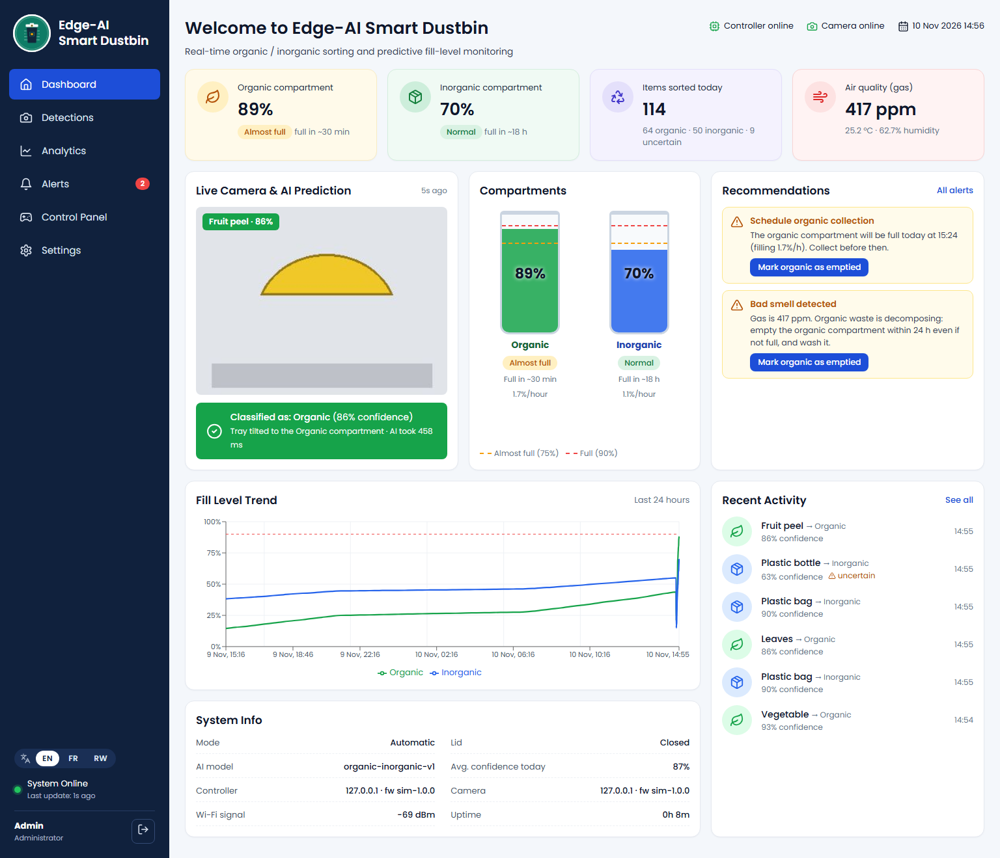

```
 ┌───────────────────────── SMART BIN ─────────────────────────┐
 │  ESP32-CAM  (camera + Edge Impulse AI model)                │
 │      │ UART "CAPTURE" / "SORT organic 0.93"                 │        Wi-Fi / HTTP
 │  ESP32 main controller ── ultrasonic x3, IR, MQ-135, DHT22 │ ───────────────────────┐
 │      └── servos (lid + sorting tray), LEDs, buzzer          │                        │
 └─────────────────────────────────────────────────────────────┘                        ▼
                                                     ┌─────────────────────────────────────────┐
   Any browser (PC, phone)  ◀────── http://localhost:8000 ──────│  Django + REST API + SQLite/PostgreSQL  │
   React dashboard: monitor, analytics, control      │  prediction · alerts · email · i18n     │
                                                     └─────────────────────────────────────────┘
```

---

## Screenshots

| | |
|---|---|
| **Login** (EN / FR / RW) 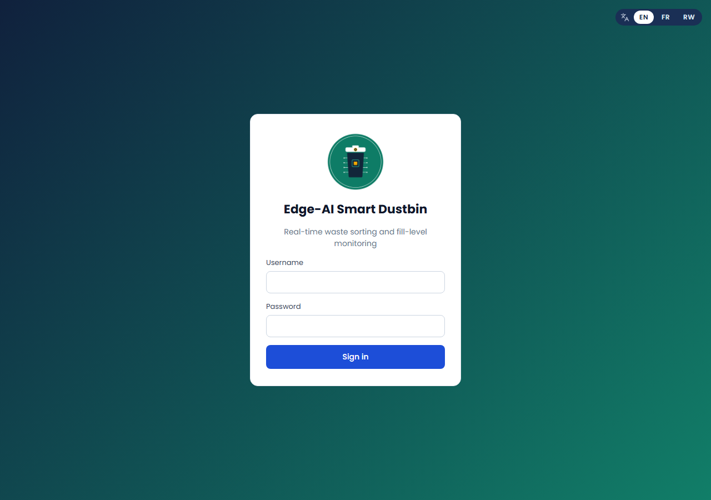 | **Detections**: every item with its photo 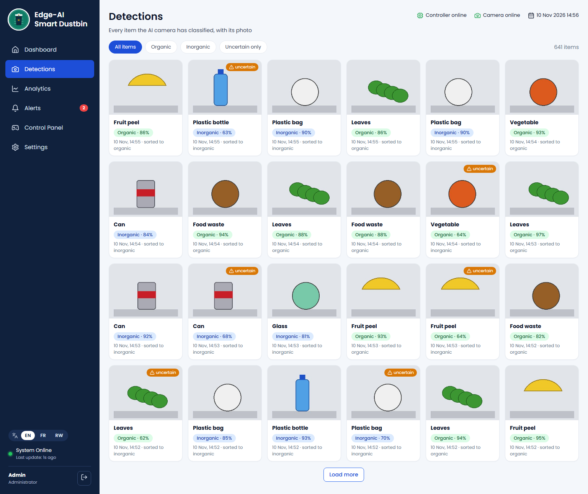 |
| **Analytics**: per day, busiest hours, AI accuracy, CSV 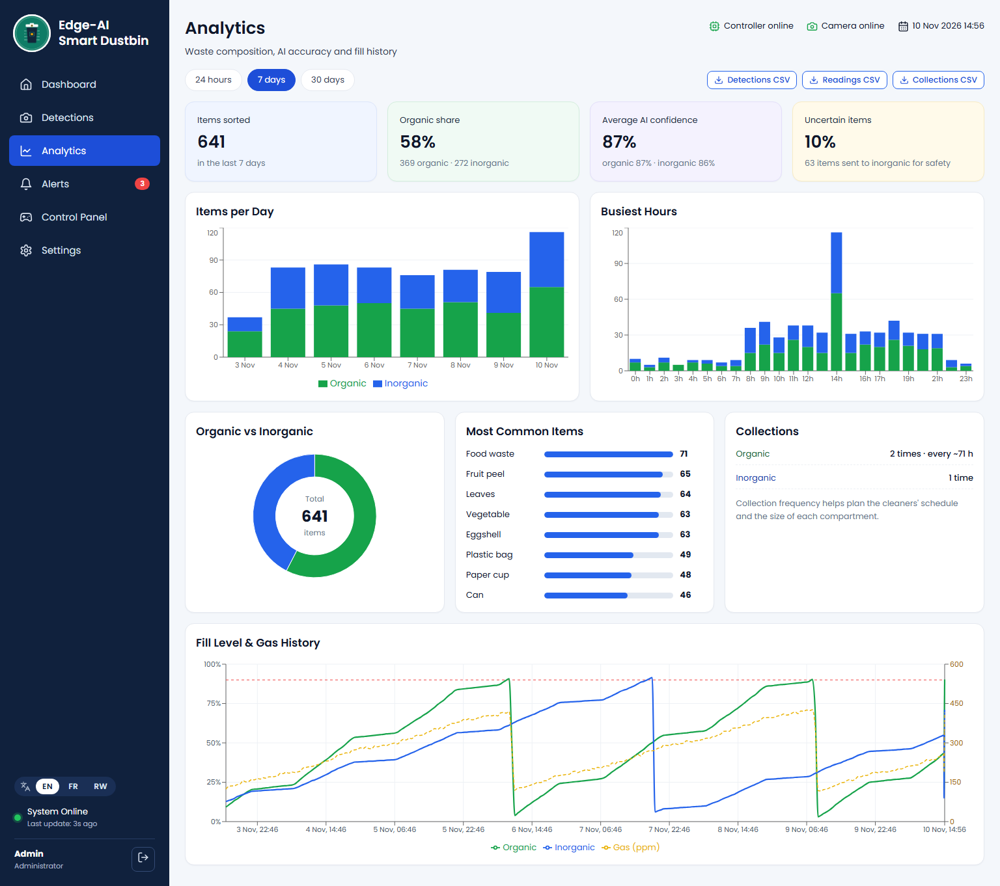 | **Control Panel**: remote commands, modes, collections 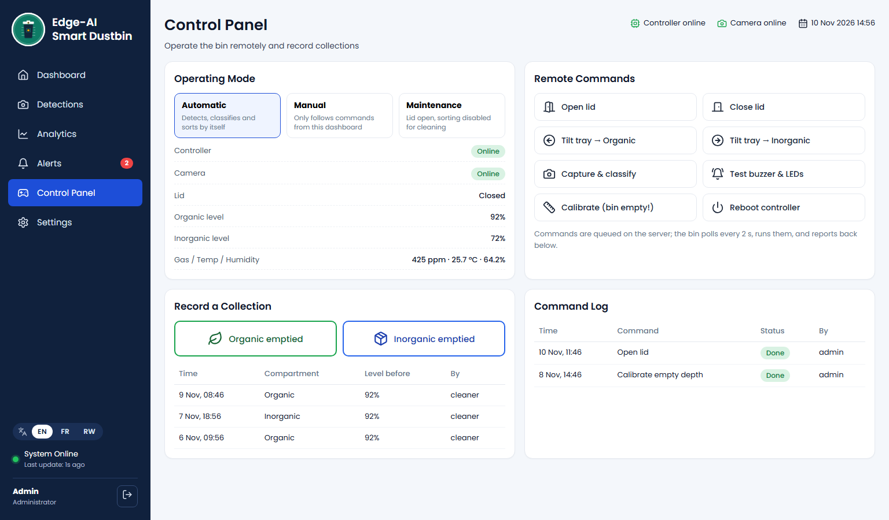 |
| **Dashboard in Kinyarwanda** 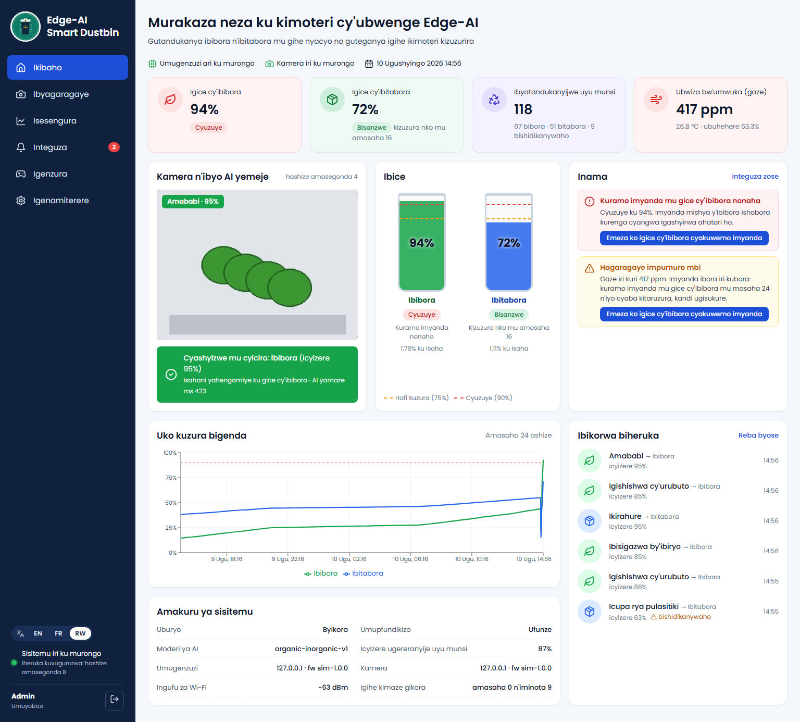 | **Dashboard in French** 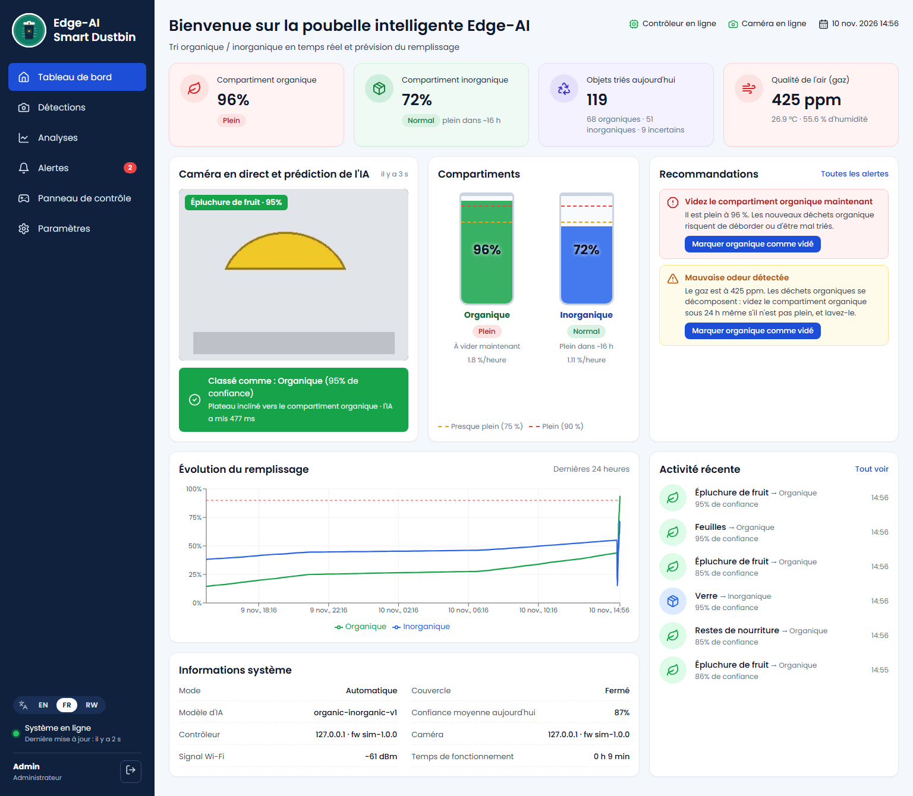 |
| **Settings & email alerts** 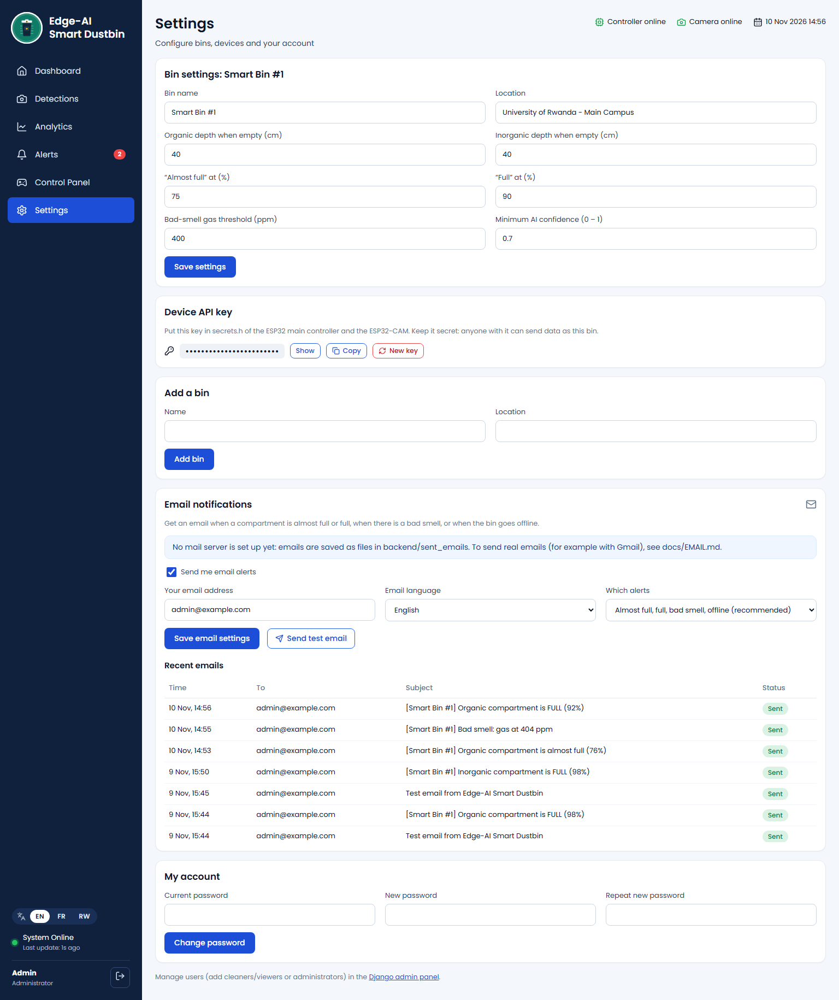 | **Alert email** received by users 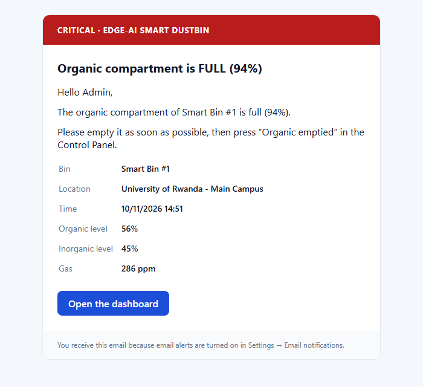 |
| **Alerts & recommendations** 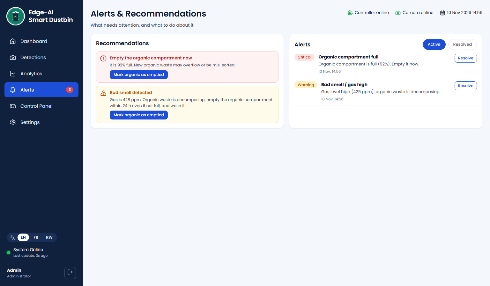 | **Phone** 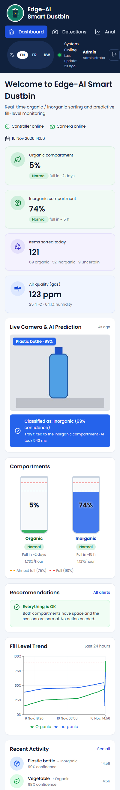 |

---

## Run it on any Windows computer (after downloading from GitHub)

1. Install **Python 3.11+** (tick "Add Python to PATH") and **Node.js 18+**.
2. Download the project: green **Code** button → **Download ZIP** (then unzip), or
   `git clone https://github.com/ruta54-create/final-project.git`
3. Double-click **`RUN_DEMO.bat`**. The first time, it automatically:
   creates the Python environment, installs the packages, installs and builds the React dashboard,
   creates the SQLite database and demo data, starts the server and a simulated bin, and opens the browser.
   This takes 3–5 minutes; afterwards it starts in about 30 seconds.
4. Log in at **http://localhost:8000**:

| Account | Password | Can do |
|---|---|---|
| `admin` | `admin12345` | everything: settings, remote control, users |
| `cleaner` | `cleaner12345` | view everything, record "compartment emptied" |

> These are **demo** accounts created on your own computer. Change the passwords in Settings → My account.

| Launcher | What it starts |
|---|---|
| `RUN_DEMO.bat` | website + simulated bin (no hardware needed) |
| `RUN_WEBSITE.bat` | website only (use with the real ESP32 bin) |
| `RUN_SIMULATOR.bat` | only the simulated bin (website already running) |

---

## Features

| Area | What it does |
|---|---|
| **Edge AI sorting** | ESP32-CAM runs an Edge Impulse CNN (organic vs inorganic) in ~0.5 s. Unsure items (< 70 % confidence) go to *inorganic* so compost is never contaminated. |
| **Fill levels** | Ultrasonic sensor above each compartment → % full, every 30 s (median of 5 readings). |
| **Prediction (ML)** | Linear-regression filling rate → "organic full in 6 h (tomorrow 04:30)". |
| **Smell & climate** | MQ-135 gas + DHT22 temperature/humidity → "organic waste decomposing, empty within 24 h". |
| **Recommendations** | Rule engine turns data into actions (empty now, schedule collection, clean lens/retrain model, …). |
| **Alerts** | Full / almost full / gas high / device offline / AI often uncertain, auto-resolved. |
| **Email alerts** | Each user gets an email (EN/FR/RW) when a compartment is almost full or full, smells bad or goes offline. Outbox with retries, anti-flood, Gmail/SMTP ready. |
| **Remote control** | Open/close lid, tilt tray, capture, calibrate, test buzzer, reboot, change mode (Auto / Manual / Maintenance). |
| **Touchless lid** | Hand sensor opens the lid, closes after 5 s. |
| **Dashboard** | Live camera photo, compartments, trends, detections gallery, analytics, CSV export. |
| **3 languages** | English, Français, Kinyarwanda: switch with EN / FR / RW; the choice is remembered. |
| **Users & security** | Login, admin vs viewer roles, one secret API key per bin, CSRF protection. |
| **Many bins** | Add bins in Settings, switch between them at the top of every page. |

---

## What is in this repository

```
final-project/
├── README.md                       this page
├── RUN_DEMO.bat                    start website + simulated bin (double-click)
├── RUN_WEBSITE.bat                 start website only (first run installs everything)
├── RUN_SIMULATOR.bat               start only the simulated bin
├── logo.png, structure.jpeg        project logo and the original dashboard design
│
├── backend/                        SERVER: Python · Django 5 · Django REST Framework
│   ├── manage.py                   Django command-line entry point
│   ├── requirements.txt            Python packages
│   ├── .env.example                settings template (database, email): copy to .env
│   ├── config/
│   │   ├── settings.py             database (SQLite / PostgreSQL), email, security
│   │   └── urls.py                 /api → Django, /admin, /media, everything else → React
│   └── bins/                       the smart-bin application
│       ├── models.py               database tables: Bin, SensorReading, Detection, Command,
│       │                           Alert, Collection, NotificationSettings, EmailNotification
│       ├── views_device.py         API for the ESP32 boards (X-API-KEY)
│       ├── views_dashboard.py      API for the dashboard: overview, analytics, commands, export
│       ├── views_notifications.py  API for email settings, test email, email log
│       ├── views_auth.py           login, logout, password change
│       ├── auth.py                 device API-key authentication
│       ├── serializers.py          input validation and JSON output
│       ├── email_backend.py        saves emails as .eml files when no mail server is set
│       ├── services/
│       │   ├── prediction.py       fill-rate regression and time-to-full (ML)
│       │   ├── alerts.py           create / auto-resolve alerts
│       │   ├── recommendations.py  rule engine: what the cleaner should do
│       │   ├── notifications.py    email outbox, background sending, retries, anti-flood
│       │   └── email_content.py    alert emails in English, French, Kinyarwanda (text + HTML)
│       ├── management/commands/
│       │   ├── seed_demo.py        demo users + 7 days of demo data
│       │   ├── create_bin.py       register a real bin and print its API key
│       │   └── send_notifications.py  send/retry emails, check offline bins
│       ├── migrations/             database schema history
│       └── tests/                  47 automated tests
│
├── frontend/                       DASHBOARD: React 18 · Vite · Recharts
│   ├── package.json                JavaScript packages
│   ├── public/logo.png
│   └── src/
│       ├── main.jsx, App.jsx       start-up, login gate, page routes
│       ├── api.js                  calls to the Django API (session + CSRF), live polling
│       ├── context.jsx             logged-in user, selected bin
│       ├── styles.css              all styling
│       ├── i18n/                   translations
│       │   ├── index.jsx           language switching, date/time formatting
│       │   └── locales/en.js, fr.js, rw.js   344 phrases in each language
│       ├── components/             Sidebar, Header, CameraCard, Compartments, TrendChart,
│       │                           Recommendations, ActivityList, EmailSettings, LanguageSwitcher
│       └── pages/                  Login, Dashboard, Detections, Analytics, Alerts, Control, Settings
│
├── device/                         HARDWARE CODE
│   ├── esp32_main/esp32_main.ino   main controller: sensors, servos, LEDs, commands
│   ├── esp32_cam/esp32_cam.ino     camera + Edge Impulse AI + photo upload
│   ├── */secrets.example.h         Wi-Fi / server / API-key template: copy to secrets.h
│   └── simulator.py                fake bin that behaves like both boards
│
├── tools/
│   ├── system_check.py             32-point check of the running system
│   └── check_i18n.mjs              verifies the 3 languages are complete
│
└── docs/                           DOCUMENTATION (see table below) + screenshots/
```

### Not in GitHub on purpose (and how each is recreated)

| Item | Why it is not uploaded | How you get it back |
|---|---|---|
| `backend/.env` | contains passwords and the secret key | `RUN_*.bat` copies `.env.example` → `.env`; edit it |
| `backend/venv/` | Python packages (~100 MB), different on every PC | created by `RUN_*.bat` from `requirements.txt` |
| `frontend/node_modules/` | JavaScript packages (~150 MB) | `npm install` (done by `RUN_*.bat`) |
| `frontend/dist/` | built dashboard, generated from `src/` | `npm run build` (done by `RUN_*.bat`) |
| `backend/db.sqlite3` | your database with live data | created by `migrate` + `seed_demo` on first run |
| `backend/media/`, `backend/sent_emails/` | camera photos and saved emails (generated data) | created automatically while the system runs |
| `device/*/secrets.h` | your Wi-Fi password and bin API key | copy `secrets.example.h` and fill it in |

---

## Documentation

| Document | Contents |
|---|---|
| [docs/PROJECT_PLAN.md](docs/PROJECT_PLAN.md) | Problem, objectives, what was improved from the first idea, 12-week plan, risks |
| [docs/ARCHITECTURE.md](docs/ARCHITECTURE.md) | How the parts talk, data flow, database tables, security, languages, deployment |
| [docs/HARDWARE.md](docs/HARDWARE.md) | Components list, wiring tables, power, mechanical build, calibration |
| [docs/AI_MODEL.md](docs/AI_MODEL.md) | Dataset, training in Edge Impulse, deployment, prediction & recommendation logic |
| [docs/API.md](docs/API.md) | Every API endpoint with examples |
| [docs/EMAIL.md](docs/EMAIL.md) | Email alerts: turning them on, Gmail setup, how sending works |
| [docs/USER_GUIDE.md](docs/USER_GUIDE.md) | How to use each dashboard page |
| [docs/TESTING.md](docs/TESTING.md) | How the system was tested and the results |

---

## Common commands

```powershell
cd backend
venv\Scripts\activate
python manage.py runserver 0.0.0.0:8000     # start the server
python manage.py test bins                  # run the 47 automated tests
python manage.py seed_demo                  # reset demo data
python manage.py create_bin "Library bin" --location "Library"   # register a real bin
python manage.py createsuperuser            # create your own admin account
python manage.py send_notifications --check-offline   # send pending emails, check offline bins

cd frontend
npm run dev        # live-reload development on http://localhost:5173
npm run build      # rebuild the dashboard that Django serves on :8000

node tools/check_i18n.mjs                   # check the translations
```

## Moving to production (PostgreSQL)

In `backend/.env` set `DB_ENGINE=postgresql`, fill `DB_NAME / DB_USER / DB_PASSWORD`, set `DJANGO_DEBUG=0`
and a long random `DJANGO_SECRET_KEY`, then `python manage.py migrate`. See *Deployment* in
[docs/ARCHITECTURE.md](docs/ARCHITECTURE.md).
