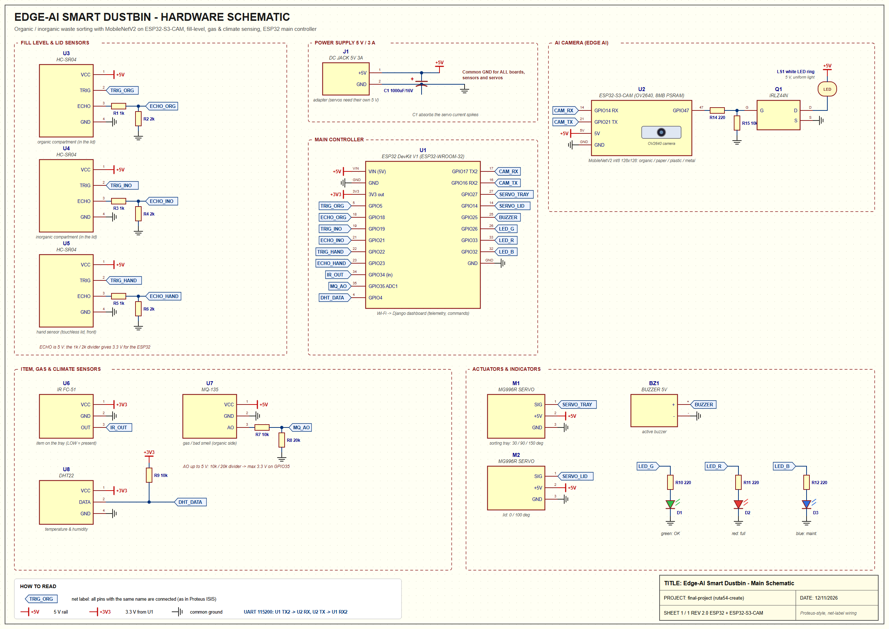

# Build Guide: from zero to a complete Edge-AI Smart Dustbin

This guide takes you from **"I have nothing"** to **"the bin sorts waste by itself and the dashboard shows
everything"**. Every wire is explained: **where it goes and why**. Follow the phases in order. Each phase ends
with a **test**. Don't start the next phase until the test passes; then, if something breaks, you know it's in
the last thing you did.



| Phase | What you do | Time | Result |
|---|---|---|---|
| [0](#phase-0-understand-the-system) | Understand the system | 1 hour | You know what every part does |
| [1](#phase-1-buy-the-parts-and-tools) | Buy the parts and tools | 1–2 weeks (delivery) | Everything on your table |
| [2](#phase-2-prepare-the-computer) | Prepare the computer | 2 hours | Arduino IDE + dashboard ready |
| [3](#phase-3-put-the-ai-model-into-an-arduino-library) | Put the AI model into an Arduino library | 1 hour | `.zip` library from Edge Impulse |
| [4](#phase-4-bench-build-one-part-at-a-time) | Bench build: one part at a time, on a breadboard | 2–3 days | Every sensor and motor tested alone |
| [5](#phase-5-install-the-real-firmware) | Install the real firmware | 2 hours | Both boards online on the dashboard |
| [6](#phase-6-full-system-test-on-the-bench) | Full system test on the bench | 1 hour | Item → AI → servo → dashboard |
| [7](#phase-7-build-the-bin-mechanics) | Build the bin (mechanics) | 3–5 days | Parts mounted in the real bin |
| [8](#phase-8-calibrate) | Calibrate | 2 hours | Correct levels, angles, gas values |
| [9](#phase-9-make-the-ai-better-with-your-own-photos) | Make the AI better with your own photos | 1 week | Higher accuracy in *your* bin |
| [10](#phase-10-final-acceptance-test-and-demo) | Final acceptance test and demo | 1 day | Ready to present |

[Troubleshooting](#troubleshooting) · [Safety](#safety-rules) · [Pin map](#appendix-a-complete-pin-map) ·
[Messages between the parts](#appendix-b-how-the-parts-talk-to-each-other)

---

## Phase 0: Understand the system

### 0.1 The big picture

```
                         Wi-Fi (HTTP + JSON, X-API-KEY)
   ┌──────────────────────────────────────────────────────────────────────┐
   │                                                                      ▼
┌──┴────────────────────────┐   UART (2 wires)   ┌───────────────────────────┐    ┌──────────────────────┐
│  ESP32-S3-CAM  ("eyes")   │◄──── CAPTURE ──────┤  ESP32 DevKit ("brain")   │    │  PC / server         │
│  camera + AI model        │───── SORT organic ─►  sensors + motors         ├───►│  Django + database   │
│  (MobileNetV2 int8)       │      0.93          │  (Wi-Fi to the server)    │    │  React dashboard     │
└───────────────────────────┘                    └─────────────┬─────────────┘    │  email alerts        │
         uploads photo + result to Django                      │                  └──────────────────────┘
                                                               │
   3 × ultrasonic (organic level, inorganic level, hand) · IR (item on tray) · MQ-135 (smell) · DHT22 (temp/humidity)
   2 × servo (tray, lid) · buzzer · 3 LEDs
```

### 0.2 What happens when someone throws something away

| # | What happens | Done by | Why this way |
|---|---|---|---|
| 1 | A hand comes within 15 cm of the front sensor → the **lid opens** | DevKit + HC-SR04 "hand" + lid servo | Touchless: hygienic |
| 2 | The person puts **one item** on the tray | | One item at a time = one photo, one decision |
| 3 | The **IR sensor** sees the item → the lid closes after a short time | DevKit + FC-51 | A closed box gives the camera constant light, and keeps hands away from the moving tray |
| 4 | DevKit sends `CAPTURE` to the camera over UART | DevKit → camera | The camera board only works when asked: simple and reliable |
| 5 | The camera takes a photo, the **AI runs on the camera chip** (≈ 0.3–0.7 s) and answers `SORT organic 0.93` | ESP32-S3-CAM | **Edge AI**: no internet is needed to sort, and no video is sent anywhere |
| 6 | The **tray tilts** left (organic) or right (inorganic) and comes back | DevKit + tray servo | |
| 7 | The camera uploads the photo + result to Django | ESP32-S3-CAM → Wi-Fi | So people can check the AI on the dashboard (teach-the-AI loop) |
| 8 | Every 30 s the DevKit sends fill levels, gas, temperature, humidity | DevKit → Wi-Fi | Dashboard, predictions ("full in 6 h"), email alerts |
| 9 | Every 2 s the DevKit asks the server for commands (open lid, calibrate, ...) | DevKit ← Wi-Fi | Control from the dashboard without opening ports on the bin |

**Classes → compartments:** organic + paper → **ORGANIC**; plastic + metal → **INORGANIC**.
**Safety rule:** if the AI is less than 70 % sure, the item goes to **INORGANIC** (a plastic bottle in the compost
spoils it; a banana peel in the inorganic bin does much less harm).

### 0.3 Why two boards and not one?

* The camera board uses almost all its pins for the camera (16 pins) and its CPU and memory for the AI.
  There aren't enough free pins left for 3 ultrasonic sensors, 2 servos, IR, gas, DHT22, buzzer and 3 LEDs.
* Servos create electrical noise and current spikes. Keeping them on another board keeps the camera stable.
* Each board can be tested and repaired alone. If the camera fails, the DevKit still measures fill levels and
  sorts to INORGANIC by itself (safe default).

### 0.4 Why these sensors?

| Sensor | Measures | Why this one |
|---|---|---|
| HC-SR04 (×3) | distance with ultrasound | cheap, 2–400 cm, works in the dark; fill level = bin depth − distance to the waste |
| FC-51 IR | "something is on the tray" | instant answer; the AI only runs when there is really an item |
| MQ-135 | gases (CO₂, NH₃, alcohol...) | rising value = organic waste decomposing → "empty the organic bin" before it smells |
| DHT22 | temperature, humidity | heat + humidity make organic waste rot faster; it explains the gas values |
| MG996R (×2) | servo motor | metal gears, strong enough (≈ 10 kg·cm) to tilt a tray with a 500 g item |

---

## Phase 1: Buy the parts and tools

### 1.1 Electronics

| # | Part | Qty | Why | ≈ USD |
|---|---|---|---|---|
| 1 | **ESP32-S3-CAM** with OV2640 camera, 8 MB PSRAM (for example Freenove ESP32-S3 WROOM CAM) | 1 | camera + AI. The S3 chip has AI instructions: 2–3× faster than the old ESP32-CAM | 12–15 |
| 2 | **ESP32 DevKit V1** (30 or 38 pins, CP2102 or CH340 USB chip) | 1 | main controller | 6 |
| 3 | HC-SR04 ultrasonic sensor | 3 (+1 spare) | organic level, inorganic level, hand | 4 × 1.5 |
| 4 | IR obstacle sensor FC-51 | 1 | item on tray | 1 |
| 5 | MQ-135 gas sensor **module** (with AO pin) | 1 | smell | 3 |
| 6 | DHT22 / AM2302 | 1 | temperature + humidity | 4 |
| 7 | MG996R servo (metal gear) | 2 | tray + lid | 2 × 5 |
| 8 | White LED ring 5 V (or 12 white 5 mm LEDs with resistors) | 1 | constant light for the camera | 2 |
| 9 | IRLZ44N MOSFET (logic level) | 1 | lets a 3.3 V pin switch the LED ring | 0.5 |
| 10 | Active buzzer 3–5 V | 1 | sounds | 0.5 |
| 11 | LEDs green, red, blue (5 mm) | 1 each | status | 0.3 |
| 12 | Resistors: 220 Ω ×5, 1 kΩ ×3, 2 kΩ ×3, 10 kΩ ×3, 20 kΩ ×1 | | dividers, LED current, pull-ups | 1 |
| 13 | **5 V power adapter, 5 A** (3 A minimum) + DC barrel jack (female) | 1 | powers everything (see 1.3) | 6–8 |
| 14 | Electrolytic capacitor 1000 µF 16 V + ceramic 100 nF ×2 | | absorb servo current spikes | 0.5 |
| 15 | Breadboard 830 holes ×2, jumper wires (M-M, M-F), perfboard 7×9 cm | | prototype, then final board | 6 |
| 16 | Wire 20–22 AWG red + black (≈ 2 m each) | | power lines for servos | 2 |
| 17 | 2-pin screw terminals ×4, pin headers, heat-shrink tube | | solid connections | 2 |
| 18 | USB-C cable (data, not "charge only") + micro-USB cable | 1 each | programming both boards | |

> **Using the old AI-Thinker ESP32-CAM instead?** It works (select `BOARD_AI_THINKER` in
> `device/esp32_cam/camera_pins.h`), but it's slower, it needs an **ESP32-CAM-MB** USB adapter to program it,
> and its pins are different: UART RX = GPIO 13, TX = GPIO 14, light = GPIO 4.

### 1.2 Tools

| Tool | Why |
|---|---|
| **Multimeter** (most important) | check 5 V / 3.3 V, check continuity, find shorts *before* powering |
| Soldering iron 40–60 W + solder | perfboard and sensor wires in the final bin |
| Wire stripper, small screwdrivers, cutter | |
| Hot glue gun, double-sided tape, zip ties, M3 screws | mount sensors and boards |
| Drill + saw (or ask a carpenter) | holes in the bin, tray and box |

### 1.3 Power budget: why 5 V 5 A

| Part | Normal current | Peak current |
|---|---|---|
| ESP32 DevKit (Wi-Fi) | 120 mA | 350 mA |
| ESP32-S3-CAM (camera + Wi-Fi + AI) | 250 mA | 500 mA |
| MG996R tray | 150 mA moving | up to 2.5 A when blocked |
| MG996R lid | 150 mA moving | up to 2.5 A when blocked |
| MQ-135 heater | 150 mA | 150 mA |
| LED ring | 200 mA | 300 mA |
| 3 × HC-SR04, IR, DHT22, buzzer, LEDs | 100 mA | 150 mA |
| **Total** | **≈ 1.1 A** | **≈ 3–5 A** |

When a servo starts or gets blocked it pulls a lot of current at once. If the adapter is too small the
voltage drops below what the ESP32 needs and **the board resets in the middle of sorting**. 5 A gives room for
both servos moving; the 1000 µF capacitor supplies the first milliseconds of each spike.

---

## Phase 2: Prepare the computer

### 2.1 Arduino IDE and the ESP32 boards

1. Install **Arduino IDE 2** from arduino.cc.
2. *File → Preferences → Additional boards manager URLs*: paste
   `https://espressif.github.io/arduino-esp32/package_esp32_index.json`
3. *Tools → Board → Boards Manager* → search **esp32** (by Espressif) → **Install**.
   If the Edge Impulse library later fails to compile, install version **2.0.17** of this package instead.
4. *Tools → Manage Libraries*, install:
   **ArduinoJson** (v7, Benoit Blanchon), **ESP32Servo**, **DHT sensor library** (Adafruit) and
   **Adafruit Unified Sensor**.
5. USB driver: plug the DevKit in. If no new COM port appears in *Tools → Port*, install the driver for
   the chip printed on the board: **CP210x** (Silicon Labs) or **CH340** (WCH).

**Test:** *File → Examples → 01.Basics → Blink*, board **ESP32 Dev Module**, choose the port, **Upload**.
Upload ends with "Hard resetting via RTS pin".
(If upload hangs on "Connecting....", hold the **BOOT** button until it starts.)

### 2.2 The dashboard

1. Double-click **`RUN_WEBSITE.bat`** in the project folder. The browser opens http://localhost:8000.
2. Log in → **Settings** → copy the **Device API key** (for example `demo-key-bin-001`).
3. Find the PC's IP address on your Wi-Fi: open *Command Prompt* → `ipconfig` → **IPv4 Address**
   (for example `192.168.1.10`). The boards will use `http://192.168.1.10:8000`.
4. When Windows asks, **allow Python through the firewall** on *private networks*. Otherwise the boards can't
   reach the server.

**Why the IP and not "localhost"?** "localhost" means "this same device". For the ESP32, "localhost" would be
the ESP32 itself. The boards must use the PC's address on the Wi-Fi network.

> The PC and both boards must be on the **same Wi-Fi**, and it must be **2.4 GHz** (the ESP32 has no 5 GHz
> radio). A phone hotspot set to 2.4 GHz works well for demos.

---

## Phase 3: Put the AI model into an Arduino library

The trained model is `ml/output/model_int8.tflite`. The camera sketch uses it through an **Arduino library made
by Edge Impulse**, which adds the code to run it on the ESP32-S3 quickly.

1. (Optional but recommended) Check the model first in Google Colab:
   [ml/verify_model_colab.ipynb](https://colab.research.google.com/github/ruta54-create/final-project/blob/main/ml/verify_model_colab.ipynb)
   → *Runtime → Run all* → the verdict must say **MODEL VERIFIED**.
2. Follow **[EDGE_IMPULSE.md](EDGE_IMPULSE.md), part A** (Bring your own model). The settings that matter:
   input **128×128 RGB**, scaling **0..255**, resize **Fit shortest axis**, labels in order
   **organic, paper, plastic, metal**.
3. *Deployment → Arduino library → Quantized (int8) → Build* → you get a `.zip`.
4. Arduino IDE → *Sketch → Include Library → Add .ZIP Library* → choose the zip.
5. Open `device/esp32_cam/esp32_cam.ino` and change the first `#include` to the name of your library,
   for example `#include <edge-ai-smart-dustbin_inferencing.h>`.

**Test:** the camera sketch **compiles** (*Verify* button) with board **ESP32S3 Dev Module**,
*PSRAM: OPI PSRAM*, *Partition scheme: Huge APP*. Compiling takes several minutes the first time: the AI library
is big.

---

## Phase 4: Bench build, one part at a time

### 4.0 Rules for the whole phase

* **Unplug the power before changing any wire.**
* Build on the breadboard. Add **one component, upload its test sketch, see it work**, then the next.
  The test sketches are in [`device/hardware_tests/`](../device/hardware_tests/).
* Colours: **red = +5 V**, **orange = +3.3 V**, **black = GND**, other colours = signals.
* Open the *Serial Monitor* at **115200** baud to read the test results.
* For now, power the DevKit **from USB**. The external 5 V adapter comes in step 4.7 (servos).

### 4.1 Why these pins on the ESP32 DevKit? (read once)

The ESP32 has 30+ pins, but **not all of them are safe to use**:

| Pins | Rule | Consequence in this project |
|---|---|---|
| GPIO 6–11 | used by the internal flash memory | **never used** |
| GPIO 0, 2, 12, 15 | "strapping" pins: their level at power-on decides how the chip boots. GPIO 12 high at boot → board won't start | **not used** |
| GPIO 34, 35, 36, 39 | **input only**, no internal pull-up | perfect for sensors that only send: IR (34), MQ-135 (35) |
| ADC2 pins (0, 2, 4, 12–15, 25–27) | can't read analog values while **Wi-Fi is on** | the gas sensor uses **GPIO 35 = ADC1** |
| GPIO 16, 17 | default pins of the 2nd hardware serial port (UART2) | link to the camera |
| Every GPIO | works at **3.3 V**. More than 3.6 V on a pin can destroy it | 5 V signals (HC-SR04 ECHO, MQ-135 AO) go through **voltage dividers** |

**Voltage divider (used 4 times).** Two resistors in series from the 5 V signal to GND; the pin is connected
between them: `V_pin = V_in × R2 / (R1 + R2)`.
* HC-SR04 ECHO: R1 = 1 kΩ, R2 = 2 kΩ → 5 V × 2/3 = **3.33 V**
* MQ-135 AO: R1 = 10 kΩ, R2 = 20 kΩ → 5 V × 2/3 = **3.33 V** (bigger values so the divider doesn't load the
  sensor's weak output)

```
 5 V signal ──[ R1 ]──┬──► ESP32 pin
                      │
                    [ R2 ]
                      │
                     GND
```

### 4.2 Power rails on the breadboard

| From | To | Why |
|---|---|---|
| DevKit **VIN** (also labelled 5V) | breadboard **red rail (+5 V)** | while USB is connected, VIN carries the USB 5 V: enough for the small sensors |
| DevKit **3V3** | breadboard **second rail (+3.3 V)** | for the IR sensor and DHT22, so their outputs are 3.3 V |
| DevKit **GND** | both **blue rails (GND)** | every part must share the same GND to read signals correctly |

**Test:** multimeter between red rail and GND ≈ **4.7–5.0 V**; 3.3 V rail ≈ **3.3 V**.

### 4.3 Status LEDs and buzzer

| Wire | From | To | Why |
|---|---|---|---|
| 1 | GPIO 26 | 220 Ω → **green** LED long leg (anode); short leg → GND | 220 Ω limits the current to ≈ 6 mA: protects the LED and the pin |
| 2 | GPIO 33 | 220 Ω → **red** LED → GND | red = a compartment is full / error |
| 3 | GPIO 32 | 220 Ω → **blue** LED → GND | blinking blue = maintenance mode |
| 4 | GPIO 25 | buzzer **+** (long leg); buzzer **−** → GND | an *active* buzzer beeps by itself when it gets voltage, no tone code needed |

> Louder buzzer? A 5 V buzzer on a 3.3 V pin is quieter. For full volume: GPIO 25 → 1 kΩ → base of an NPN
> transistor (2N2222), emitter → GND, collector → buzzer −, buzzer + → 5 V.

**Test:** upload `01_leds_buzzer`. Green, red and blue light up in turn, then a beep.

### 4.4 Ultrasonic sensors (×3)

Connect **one sensor, test, then the next**.

| Wire | Sensor pin | To | Why |
|---|---|---|---|
| 1 | VCC | +5 V rail | the HC-SR04 is a 5 V sensor; at 3.3 V many units don't measure |
| 2 | GND | GND rail | |
| 3 | TRIG | GPIO 5 (organic), 19 (inorganic), 22 (hand) | the ESP32 sends a 10 µs pulse = "send a sound burst". 3.3 V is enough to trigger it |
| 4 | ECHO | **1 kΩ** → GPIO 18 / 21 / 23, and that GPIO → **2 kΩ** → GND | ECHO is a **5 V** pulse: its length = time for the sound to go and come back. The divider makes it 3.3 V |

Distance = echo time × 343 m/s ÷ 2 (the sound goes there and back).
Fill level = (empty depth − distance) ÷ empty depth × 100 %.

**Test:** upload `02_ultrasonic`. Each line shows 3 distances. Hold a book 20 cm in front of a sensor:
it shows ≈ 20 cm. `--` = no echo: check the divider and that TRIG/ECHO are not swapped.

### 4.5 IR sensor (item on the tray)

| Wire | Sensor pin | To | Why |
|---|---|---|---|
| 1 | VCC | **+3.3 V** rail | then its OUT pin gives 3.3 V: safe for the ESP32 with no divider |
| 2 | GND | GND | |
| 3 | OUT | GPIO 34 | input-only pin; the module has its own pull-up. OUT = **LOW** when something is in front |

**Test:** upload `03_ir_tray`. Put your hand 5 cm in front → `ITEM ON TRAY`. Turn the blue potentiometer
on the module to adjust the distance (later: it should see items on the tray but not the tray itself).

### 4.6 MQ-135 gas and DHT22

| Wire | Pin | To | Why |
|---|---|---|---|
| 1 | MQ-135 VCC | +5 V | the heater inside needs 5 V (≈ 150 mA). It gets warm: that's normal |
| 2 | MQ-135 GND | GND | |
| 3 | MQ-135 AO | **10 kΩ** → GPIO 35, and GPIO 35 → **20 kΩ** → GND | AO goes up to 5 V → divider to 3.3 V. GPIO 35 is ADC1: still readable with Wi-Fi on |
| 4 | MQ-135 DO | not connected | DO is only an on/off threshold; we want the real value |
| 5 | DHT22 VCC (pin 1) | +3.3 V | data line then stays 3.3 V |
| 6 | DHT22 DATA (pin 2) | GPIO 4, **plus 10 kΩ from DATA to +3.3 V** | the DHT22 data line is "open drain": it can only pull it low. The 10 kΩ pulls it back high |
| 7 | DHT22 GND (pin 4) | GND | pin 3 of the bare DHT22 is not used |

**Test:** upload `04_dht22` → room temperature and humidity; breathe on it → humidity rises.
Upload `05_mq135`, wait 2 minutes → values become stable; hold a cotton ball with some alcohol or hand sanitizer
near it → **Rs goes down** (more gas = lower resistance).

### 4.7 Servos and the external 5 V supply

From now on the **5 V 5 A adapter** powers the servos. This is the part where most beginners have problems,
so follow it exactly.

```
 5 V adapter (+) ──┬───────────────┬─────────────── tray servo RED
                   │               └─────────────── lid servo  RED
                [1000 µF]  (+ leg to +5 V)
                   │
 5 V adapter (−) ──┴──┬──────────── tray servo BROWN
                      ├──────────── lid servo  BROWN
                      └──────────── ESP32 GND   ◄── the common ground, required
 ESP32 GPIO 27 ──────────────────── tray servo ORANGE (signal)
 ESP32 GPIO 14 ──────────────────── lid servo  ORANGE (signal)
```

| Wire | From | To | Why |
|---|---|---|---|
| 1 | adapter **+5 V** | servo **red** wires (use 20–22 AWG wire) | servos pull up to 2.5 A: the ESP32 board can't supply this and would reset |
| 2 | adapter **GND** | servo **brown** wires | |
| 3 | adapter **GND** | **ESP32 GND** | the signal is measured against GND. Without a shared GND the servo can't read the signal: it shakes or doesn't move |
| 4 | 1000 µF capacitor | across +5 V and GND, close to the servos. **The stripe (−) goes to GND** | absorbs the current spike when the servos start. Reversed, an electrolytic capacitor can burst |
| 5 | GPIO 27 | tray servo orange | PWM signal, 50 Hz; pulse length 0.5–2.4 ms = angle 0–180° |
| 6 | GPIO 14 | lid servo orange | GPIO 14 sends a short signal at boot: the lid may twitch once at power-on. Harmless |

**Test:** upload `06_servos`. In the Serial Monitor (line ending: *Newline*) type `demo` → the lid opens and
closes, the tray tilts left and right. Type `t60`, `t120`, `l80`... to find your angles (you'll fine-tune them
in phase 8 once the mechanics are built).

### 4.8 Camera board, LED ring and the UART link

| Wire | From (camera board) | To | Why |
|---|---|---|---|
| 1 | **5V** pin | +5 V (adapter) | the camera + Wi-Fi + AI draw up to 500 mA peaks: more than a long USB cable gives reliably |
| 2 | **GND** | GND (common) | shared ground for the UART link |
| 3 | **GPIO 14** (camera RX) | DevKit **GPIO 17** (TX2) | UART is crossed: what one board **sends** (TX) the other **receives** (RX) |
| 4 | **GPIO 21** (camera TX) | DevKit **GPIO 16** (RX2) | same, other direction. Both boards are 3.3 V: no divider needed |
| 5 | **GPIO 47** | 220 Ω → IRLZ44N **gate**; gate → 10 kΩ → GND | the pin gives only a few mA; the MOSFET is a switch that carries the ring's 200–300 mA. The 10 kΩ keeps the light off during boot |
| 6 | IRLZ44N **source** | GND | |
| 7 | IRLZ44N **drain** | LED ring **−** | the MOSFET switches the ring's ground side ("low-side switch") |
| 8 | LED ring **+** | +5 V | |

> **Never use GPIO 4 or 5 on the ESP32-S3-CAM:** they talk to the camera chip (SDA/SCL).
> The IRLZ44N pins, looking at the printed side with the legs down, are **G, D, S** (left to right).

Why a ring of white light? The AI was trained on reasonably lit photos. Inside a closed box with constant
white light every photo looks the same, whatever the time of day: this raises the accuracy more than anything
else (the Colab notebook shows −7 points in darker photos).

**Tests (camera board, settings: *ESP32S3 Dev Module*, *PSRAM: OPI PSRAM*, *USB CDC On Boot: Enabled*):**
1. *File → Examples → ESP32 → Camera → CameraWebServer* → in the sketch select
   `#define CAMERA_MODEL_ESP32S3_EYE` (same pins as our board) → enter your Wi-Fi → upload → open the IP shown in
   the Serial Monitor → **Start Stream**. You see live video.
2. Upload `08_led_ring` → the ring blinks every second.
3. Upload `07_uart_cam` to the camera board **and** `07_uart_main` to the DevKit → the DevKit monitor shows
   `camera says: SORT organic 0.990` every 3 s.

**Why a text protocol at 115200 baud?** A line like `SORT organic 0.93` is 18 bytes: it travels in ≈ 2 ms.
Plain text is easy to debug: you can read it in the Serial Monitor.

---

## Phase 5: Install the real firmware

### 5.1 Secrets (Wi-Fi, server, API key)

In **each** of the two folders `device/esp32_main/` and `device/esp32_cam/`:
copy `secrets.example.h` → `secrets.h` and edit:

```cpp
#define WIFI_SSID     "MyWiFi"                     // 2.4 GHz network
#define WIFI_PASSWORD "my-password"
#define SERVER_URL    "http://192.168.1.10:8000"   // PC IP from ipconfig, no "/" at the end
#define API_KEY       "demo-key-bin-001"           // dashboard → Settings → Device API key
```

`secrets.h` is in `.gitignore`: your Wi-Fi password never goes to GitHub.

### 5.2 Upload

| Sketch | Board | Settings |
|---|---|---|
| `device/esp32_main/esp32_main.ino` | **ESP32 Dev Module** | default |
| `device/esp32_cam/esp32_cam.ino` | **ESP32S3 Dev Module** | PSRAM **OPI PSRAM**, Flash **8 MB** (or 16 MB, as printed on your board), Partition **Huge APP**, USB CDC On Boot **Enabled** |

Check `device/esp32_cam/camera_pins.h`: exactly **one** `#define BOARD_...` line must be active.

**Test:** in the Serial Monitors you see:
* DevKit: `Wi-Fi OK` → `Config: bin 'Smart Bin #1', mode auto` → `Telemetry: organic 12%, ...`
* Camera: `ESP32-S3-CAM ready. Model input 128x128, 4 labels`
* Dashboard header: **Controller online** and **Camera online**.

---

## Phase 6: Full system test on the bench

Everything is still on the table, not yet in the bin.

| # | Do this | Expected |
|---|---|---|
| 1 | Dashboard → **Control** → *Test buzzer & LEDs* | 3 beeps, all LEDs on |
| 2 | *Open lid* / *Close lid* | lid servo moves |
| 3 | *Tilt tray → Organic* / *Tilt tray → Inorganic* | tray servo moves and comes back |
| 4 | Wave your hand in front of the hand sensor | lid opens, closes after 5 s |
| 5 | Hold a plastic bottle 15 cm under the camera, then cover the IR sensor | camera answers within ~1 s, tray tilts **right** (inorganic), photo appears on **Detections** |
| 6 | Same with a banana peel or paper | tray tilts **left** (organic) |
| 7 | Point an ultrasonic sensor at the floor, then at your hand | **Dashboard** level changes within 30 s |
| 8 | Unplug the camera, cover the IR sensor | after 8 s: red LED, 2 beeps, tray goes **inorganic** (safe default) |

---

## Phase 7: Build the bin (mechanics)

```
        side view                                   top view of the inspection box
 ┌────────────── LID (servo M2) ───────────┐        ┌─────────────────────────────┐
 │  [hand sensor U5, front, pointing out]  │        │     camera + LED ring       │
 │ ┌──── INSPECTION BOX (matt white) ────┐ │        │   (centre, looking down)    │
 │ │       camera + LED ring  ▼          │ │        │                             │
 │ │            ~15 cm                   │ │        │  ┌───────── TRAY ────────┐  │
 │ │   ══════ TRAY (servo M1) ══════     │ │        │  │ IR sensor at the side │  │
 │ └───────────╲───────────╱─────────────┘ │        │  └───────────────────────┘  │
 │  [U3 level]  ╲         ╱  [U4 level]    │        └─────────────────────────────┘
 │ ┌───────────┐            ┌───────────┐  │
 │ │ ORGANIC   │            │ INORGANIC │  │
 │ │ (left)    │            │ (right)   │  │
 │ │ MQ-135 +  │            │           │  │
 │ │ DHT22     │            │           │  │
 │ └───────────┘            └───────────┘  │
 └─────────────────────────────────────────┘
```

| Part | How to mount it | Why |
|---|---|---|
| **Camera** | in the box ceiling, lens pointing straight down, **≈ 15 cm** above the tray | the firmware takes the centre square of the photo. At 15 cm that square is ≈ 15 × 15 cm, so a normal item fills most of the picture. The Colab test showed accuracy falls from 91 % to 80 % when the item is small in the picture |
| **LED ring** | around the camera lens | even light, no shadows |
| **Box inside** | painted **matt white** (or white paper) | constant background; matt = no reflections |
| **Tray** | flat plate (≈ 20 × 20 cm, light plastic or plywood) on a horizontal axle through its centre; servo horn screwed to the axle | the servo only has to rotate the tray, not lift it |
| **IR sensor** | on the side of the box, at tray height, looking across the tray | it sees an item on the tray, not the tray itself (adjust the potentiometer) |
| **Level sensors U3, U4** | under the box floor, above the middle of each compartment, pointing straight down, **≥ 5 cm** above the highest waste | HC-SR04 can't measure under 2 cm; the beam must not hit the walls |
| **Hand sensor U5** | front of the bin, below the lid, pointing forward | |
| **MQ-135 + DHT22** | high in the **organic** compartment, behind a small plastic cover with holes | the gas comes from organic waste; the cover protects from liquids |
| **Boards, buzzer, LEDs** | in a small box on the back, LEDs visible from the front | away from liquids; easy to reach the USB ports |
| **Cables** | twist each sensor's wires together, use zip ties; servo power wires short and thick | less electrical noise, nothing caught by the moving tray |

Move the breadboard circuit to the **perfboard** (solder) or keep good-quality screw terminals: loose jumper
wires are the first cause of random failures in a moving bin.

---

## Phase 8: Calibrate

| What | How | Where it's saved |
|---|---|---|
| **Bin depth** (100 % = full) | empty both compartments → dashboard **Control → Calibrate (bin empty!)** | Settings (organic / inorganic depth). Depths under 10 cm are refused (sensor blocked) |
| **Tray angles** | upload `06_servos`, try `t…` until the item slides off cleanly to each side and the tray is flat at rest | `TRAY_CENTER`, `TRAY_ORGANIC`, `TRAY_INORGANIC` in `esp32_main.ino` |
| **Lid angles** | same with `l…` | `LID_CLOSED`, `LID_OPEN` |
| **Hand distance** | how close a hand must be to open the lid | `HAND_DISTANCE_CM` (default 15) |
| **MQ-135 R0** | after 24 h of first heating, outdoors in clean air: `05_mq135` → copy the stable *R0 estimate* | `MQ_R0_KOHM` |
| **Gas alarm level** | watch the normal values for a few days | dashboard **Settings** (default 400 ppm) |
| **Camera orientation** | if photos on **Detections** are upside down, change `s->set_vflip(s, 1)` to `0` (or add `set_hmirror`) | `esp32_cam.ino` |
| **AI confidence** | min confidence for organic (default 70 %). Higher = less contamination of the compost, more items to inorganic | dashboard **Settings** |

After changing the `.ino` files, upload again (the `secrets.h` stays).

---

## Phase 9: Make the AI better with your own photos

The model learned from public photos (84.8 % material / 91.3 % compartment on its test set). Your bin has its
own light, tray and local waste, so **your own photos** give the biggest improvement.

1. Use the bin normally for a few days (each item's photo is saved).
2. Dashboard → **Detections** → filter *To review* → press **Correct** or choose the right material for each photo.
3. **Analytics** shows the AI's real accuracy in your bin and its typical mistakes.
4. **Detections → Download checked photos (ZIP)** → unzip into `ml/datasets/own/` (one folder per class).
5. Retrain: `ml/prepare_dataset.py` then `ml/train_mobilenet.py` (see [DATASET_GUIDE.md](DATASET_GUIDE.md)).
6. Check the new model in Colab, upload it to Edge Impulse, build the library, upload `esp32_cam.ino` again with
   a new `MODEL_VERSION`.

Goal: **at least 100 photos per class** taken in the bin. Most important: paper vs white plastic (they cross
compartments).

---

## Phase 10: Final acceptance test and demo

| # | Test | Pass if |
|---|---|---|
| 1 | 20 items (5 per class), one at a time | ≥ 17 in the right compartment, no plastic/metal in organic |
| 2 | 20 items in a row, without pause | no reset, no stuck tray |
| 3 | Fill a compartment with paper above 90 % | dashboard alert + email + red LED + 3 beeps |
| 4 | Alcohol near the MQ-135 | gas value rises on the dashboard |
| 5 | Turn off the Wi-Fi router for 2 minutes | the bin keeps sorting; reconnects by itself; dashboard back online |
| 6 | Unplug and replug the power | both boards back online within 30 s, tray flat, lid closed |
| 7 | Dashboard *Maintenance* mode | lid stays open, blue LED blinks, no sorting |
| 8 | Leave it on for 24 h | no resets, fill-level predictions shown |

**Demo script (5 minutes):** show the dashboard → wave a hand (lid opens) → put a bottle (→ inorganic) →
put a banana peel (→ organic) → show both photos on Detections → correct one on the dashboard ("teach the AI") →
show Analytics and an email alert → explain *edge AI*: the photo is classified on the camera chip, not in the
cloud.

---

## Troubleshooting

| Symptom | Most likely cause | Fix |
|---|---|---|
| Upload stuck at "Connecting...." | board not in download mode | hold **BOOT**, press and release **RST/EN**, release BOOT when upload starts |
| No COM port | charge-only cable or no driver | another cable; install CP210x/CH340 driver |
| Board resets when a servo moves (`Brownout detector was triggered`) | servos powered from the ESP32, weak adapter, no capacitor | servos on the 5 V adapter, 1000 µF capacitor, adapter ≥ 3 A |
| Servo shakes or doesn't move | no common GND | connect adapter GND to ESP32 GND |
| Ultrasonic always `--` / 0 | TRIG/ECHO swapped, divider wrong, 3.3 V on VCC | VCC = 5 V, check divider with multimeter (≈ 3.3 V on the pin when ECHO high) |
| Level jumps around | beam hits a wall or a plastic bag | mount in the centre, pointing straight down; the firmware already uses a median of 5 readings |
| DHT22 `read failed` | no pull-up, wrong pin | 10 kΩ DATA → 3.3 V; pin 2 = DATA |
| Gas value 0 or -1 | AO not connected, sensor cold | check divider, wait 2 min |
| `!! Wrong API_KEY in secrets.h` | key copied wrong | copy again from Settings, upload |
| `Telemetry failed (-1)` | can't reach the server | same 2.4 GHz Wi-Fi? right IP? firewall allows Python? is `RUN_WEBSITE.bat` running? Test from a phone: `http://PC-IP:8000` |
| Camera `Camera init failed` | wrong board in `camera_pins.h`, PSRAM off, ribbon cable loose | choose your board, *PSRAM: OPI PSRAM*, re-seat the ribbon (dark side up / as printed) |
| `camera timeout -> inorganic` | UART wires not crossed, no common GND, camera busy restarting | TX→RX, RX←TX, shared GND; check the camera's Serial Monitor |
| Camera answers `EMPTY` | the model saw no item (only if you added a *background* class) | adjust the IR sensor so it only triggers with an item |
| AI often wrong in the bin but fine in Colab | light, distance or background differ from training | LED ring on, camera at ~15 cm, white box, then Phase 9 |
| Photos upside down | camera mounted rotated | `set_vflip` / `set_hmirror` in `esp32_cam.ino` |

---

## Safety rules

* **Unplug before rewiring.** Check with the multimeter that there is no short between +5 V and GND before
  powering a new circuit.
* Use a **certified 5 V adapter**; never connect the circuit to mains voltage directly.
* Electrolytic capacitor: **stripe (−) to GND**.
* The MQ-135 heater gets **hot** (≈ 50 °C): don't touch, don't put it against plastic that melts.
* Keep electronics **above and away from liquids**; organic waste is wet.
* The lid and tray move by themselves: keep fingers out of the box while testing; *Maintenance* mode stops sorting.
* Never commit `secrets.h` (Wi-Fi password). It's in `.gitignore`.

---

## Appendix A: Complete pin map

### ESP32 DevKit V1 (main controller)

| GPIO | Connected to | Direction | Note |
|---|---|---|---|
| 5 | HC-SR04 organic TRIG | out | |
| 18 | HC-SR04 organic ECHO | in | via 1 k / 2 k divider |
| 19 | HC-SR04 inorganic TRIG | out | |
| 21 | HC-SR04 inorganic ECHO | in | via divider |
| 22 | HC-SR04 hand TRIG | out | |
| 23 | HC-SR04 hand ECHO | in | via divider |
| 34 | FC-51 IR OUT | in | LOW = item; sensor at 3.3 V |
| 35 | MQ-135 AO | analog in (ADC1) | via 10 k / 20 k divider |
| 4 | DHT22 DATA | in/out | 10 k pull-up to 3.3 V |
| 27 | tray servo signal | PWM out | servo power from the 5 V adapter |
| 14 | lid servo signal | PWM out | |
| 25 | buzzer + | out | |
| 26 / 33 / 32 | green / red / blue LED | out | 220 Ω each |
| 17 (TX2) | camera GPIO 14 (RX) | out | UART 115200 |
| 16 (RX2) | camera GPIO 21 (TX) | in | |
| VIN | +5 V | power | |
| 3V3 | IR VCC, DHT22 VCC, pull-up | power out | |
| GND | common ground | | |

### ESP32-S3-CAM (AI camera)

| GPIO | Connected to | Note |
|---|---|---|
| 14 | DevKit GPIO 17 (TX2) | UART RX |
| 21 | DevKit GPIO 16 (RX2) | UART TX |
| 47 | IRLZ44N gate via 220 Ω (+ 10 k to GND) | LED ring |
| 4, 5, 6–13, 15–18 | camera (on the board) | **don't use** |
| 5V / GND | +5 V adapter / common GND | |

The same pins are in the firmware (`esp32_main.ino`, `camera_pins.h`) and on the schematic
([schematic/smart_dustbin_schematic.png](schematic/smart_dustbin_schematic.png)). If you change a pin, change
it in the firmware and run `python tools/draw_schematic.py` to redraw the schematic.

---

## Appendix B: How the parts talk to each other

### UART (DevKit ↔ camera), 115200 baud, one text line per message

| Direction | Message | Meaning |
|---|---|---|
| DevKit → camera | `CAPTURE` | take a photo and classify it |
| camera → DevKit | `SORT organic 0.930` / `SORT inorganic 0.880` | compartment + confidence (safety rule already applied) |
| camera → DevKit | `EMPTY` | nothing on the tray (only with an optional *background* class) |
| camera → DevKit | `ERR camera` / `ERR decode` / `ERR model` | problem; the DevKit sorts to inorganic |
| camera → DevKit | `READY` | sent once at start-up |

If the camera doesn't answer within **8 s**, the DevKit sorts to **inorganic**.

### Wi-Fi (boards → Django), header `X-API-KEY: <key>` (details in [API.md](API.md))

| Who | Request | How often | What |
|---|---|---|---|
| DevKit | `GET /api/device/config/` | at start | bin name, mode, intervals |
| DevKit | `POST /api/device/telemetry/` | every 30 s | distances, gas, temperature, humidity, lid, Wi-Fi signal → server answers with fill levels and mode |
| DevKit | `GET /api/device/commands/` | every 2 s | commands from the Control page (open lid, calibrate...) |
| DevKit | `POST /api/device/commands/<id>/ack/` | after each command | done / failed + message |
| Camera | `GET /api/device/config/?role=cam` | every 60 s | heartbeat ("Camera online") + min confidence |
| Camera | `POST /api/device/detection/` | after each item | photo + label + confidence + compartment |

The boards always **start** the connection (they ask the server). That's why the bin works behind any home or
school router without opening ports.
