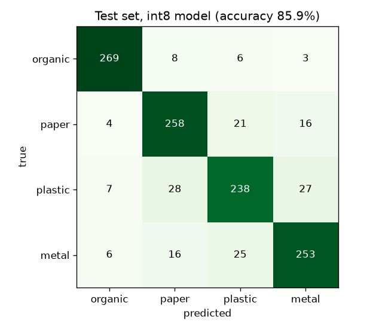
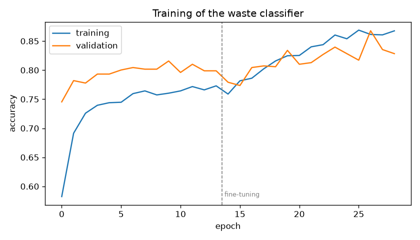

# Dataset & AI Guide: Edge-AI Smart Dustbin System

How the smart dustbin recognises waste, which data it learns from, how to train the model
**on a normal laptop**, how to put it on the **ESP32-S3-CAM**, and how the bin keeps getting smarter.

---

## 1. What the AI does

The camera above the tray takes one photo of each item. A small neural network (**MobileNetV2**) running
**on the ESP32-S3-CAM itself** (edge AI: no internet needed) says which of **4 materials** it is.
The material decides the compartment:

| Material the AI recognises | Examples | Compartment | Why |
|---|---|---|---|
| **organic** | food leftovers, fruit/vegetable peels, leaves, bread | **ORGANIC** | rots, compostable |
| **paper** | paper, newspaper, cardboard, paper bags | **ORGANIC** | biodegradable, can be composted or recycled with organics |
| **plastic** | bottles, bags, wrappers, cups | **INORGANIC** | does not rot |
| **metal** | drink cans, tins, bottle caps, foil | **INORGANIC** | does not rot |

Why 4 materials and not just "organic / inorganic"? Paper and food look completely different, and so do a
bottle and a can. Learning 4 *visual* classes is easier for a small network than learning 2 mixed groups,
and the dashboard can show **what kind** of waste people throw away (for recycling partners).

**Safety rule:** if the AI is less than 70 % sure (setting *Minimum AI confidence*), the item goes to
**inorganic**. Plastic in the compost is much worse than a peel in the inorganic bin.

---

## 2. How the whole system works, step by step

```
 1. Hand near the lid ─────────▶ lid opens (ultrasonic sensor), item dropped on the tray
 2. IR sensor sees the item ───▶ main ESP32 closes the lid (steady light) and sends "CAPTURE" to the camera
 3. ESP32-S3-CAM ──────────────▶ LED ring on, photo 320×240, centre crop → 96×96 (or 128×128)
 4. MobileNetV2 (int8) ────────▶ scores: organic 0.06 · paper 0.88 · plastic 0.04 · metal 0.02
 5. Decision ──────────────────▶ paper (88 % ≥ 70 %) → ORGANIC compartment   (unsure → INORGANIC)
 6. Camera answers "SORT organic 0.880" over UART ─▶ main ESP32 tilts the tray (servo), item falls
 7. Camera uploads photo + result to Django ───────▶ dashboard shows it within 3 s
 8. Ultrasonic sensors measure both compartments every 30 s ─▶ fill level, prediction, email when full
 9. A cleaner checks the photo on the dashboard: ✓ correct, or "it was plastic"   ("teach the AI")
10. Checked photos are exported and added to the dataset ─▶ retrain ─▶ new, better model on the camera
```

Steps 9–10 are the **continuous-learning loop**: the bin collects its own training data while it is used.

---

## 3. The datasets

Public datasets give the AI a good start. Your own photos (section 5) make it work *in your bin*.

| Dataset | Images | Classes we use → our label | Classes skipped | Look of the photos | License |
|---|---|---|---|---|---|
| **RealWaste** (UCI ML Repository, 2023) | 4,752 | Cardboard, Paper → **paper** · Food Organics, Vegetation → **organic** · Plastic → **plastic** · Metal → **metal** | Glass, Textile Trash, Miscellaneous Trash | real waste from a landfill, 524×524, varied backgrounds | CC BY 4.0 |
| **TrashNet / "Garbage Classification"** (Thung & Yang, Stanford 2016) | 2,527 | cardboard, paper → **paper** · plastic → **plastic** · metal → **metal** | glass, trash | one object on a white board, 512×384 | MIT |
| **Recyclable and Household Waste** (Kaggle, A. King) | 15,000 (8,747 recovered, see below) | food waste, eggshells → **organic** · newspaper, cardboard boxes/packaging → **paper** · shopping bags, soda bottles, cutlery → **plastic** · soda cans, food tins → **metal** | glass, clothing, shoes; office paper, magazines, coffee grounds, aerosol cans (photos mostly not the object, checked by eye); paper cups (plastic-lined) | web stock photos, 256×256 PNG, **many repeats** (1,164 identical + 565 near-identical removed) | Kaggle: MIT; data card: educational/research use |
| *Tested, not used:* **Garbage Dataset v2** (Kaggle, S. Kunwar) | 13,348 (complete download) | biological → organic and paper, plastic, metal were **tested** (see experiments below) | cardboard (≈⅓ drink cartons), battery, glass, clothes, shoes, trash | food: stock/market photos; paper/plastic/metal: real phone photos | MIT |

Download links:
* RealWaste: https://archive.ics.uci.edu/dataset/908/realwaste → *Download* (`realwaste.zip`, 690 MB)
* TrashNet: https://huggingface.co/datasets/garythung/trashnet → `dataset-resized.zip` (43 MB)
* King (needs a free Kaggle account): https://www.kaggle.com/datasets/alistairking/recyclable-and-household-waste-classification → *Download dataset as zip* (965 MB) → `king.zip`
* GD v2 (needs a free Kaggle account): https://www.kaggle.com/datasets/sumn2u/garbage-classification-v2 → `gdv2.zip`

Put RealWaste and TrashNet in **`ml/datasets/raw/`**, King and GD v2 in **`ml/datasets/raw_external/`**. You don't need
to unzip them. **Wait until the browser has finished the download**: the first King download was cut off at 505 of
965 MB. Complete images were recovered with `ml
ecover_zip.py` into `raw_external/king/` (two cut-off downloads, 11,711
images, all folders up to *plastic trash bags*). Still missing: water bottles, steel food cans, styrofoam, tea bags.
The full check of every dataset, and why some were rejected, is in **[DATASET_AUDIT.md](DATASET_AUDIT.md)**.

**Please cite** in your report:
* S. Single, S. Iranmanesh, R. Raad, "RealWaste: A Novel Real-Life Data Set for Landfill Waste Classification
  Using Deep Learning", *Information*, 14(12), 633, 2023.
* G. Thung, M. Yang, "Classification of Trash for Recyclability Status", CS229 project report, Stanford, 2016.

### What we actually used (after cleaning), dataset v2

`ml/prepare_dataset.py` centre-crops every photo to a square, removes duplicates (also across datasets), and
balances every class **by subtype**, so no single kind of object dominates a class:

| Class | Compartment | Training | Test | Sources | Subtypes (images) |
|---|---|---|---|---|---|
| organic | organic | 1,145 | 286 | RealWaste 846 · King 585 | food scraps 410 · garden waste 436 · food waste/peels 264 · eggshells 321 |
| paper | organic | 1,201 | 299 | RealWaste 547 · King 546 · TrashNet 407 | paper 278 · cardboard 269+199 · newspaper 228 · flyers/envelopes 208 · boxes 159 · packaging 159 |
| plastic | inorganic | 1,200 | 300 | King 582 · RealWaste 568 · TrashNet 350 | mixed containers/bottles 568 · clear bottles & clamshells 350 · **shopping bags 290** · **soda bottles 203** · cutlery 89 |
| metal | inorganic | 1,200 | 300 | King 611 · RealWaste 547 · TrashNet 342 | mixed 547 · cans/tins/foil 342 · **soda cans 328** · food tins 283 |
| **total** | | **4,746** | **1,185** | | |

* The **709 test photos of the first model (v1) stay in the test set** (`ml/benchmark_v1.csv`), so old and new
  models are compared on exactly the same photos, and they are never trained on.
* `manifest.csv` records the **original file and licence** of every image. `integration_report.md`,
  `summary.json` and `duplicates.csv` are written next to it.
* **Experiments with more data (22 Nov 2026).** Every model below was tested on the same 709 benchmark photos (int8):

  | Dataset | Runs (material accuracy) | Average | Compartment | Paper recall | Plastic recall |
  |---|---|---|---|---|---|
  | v1: RealWaste + TrashNet | 83.8 % | 83.8 % | 90.5 % | 0.76 | 0.77 |
  | **v2: + King (current)** | **86.6 %**, 84.5 % | **85.6 %** | 92.8 %, 91.0 % | **0.86**, 0.86 | 0.78, 0.79 |
  | v3: v2 + GD v2 food (699) | 82.8 %, 84.1 % | 83.5 % | 89.1 %, 90.7 % | 0.87, 0.87 | 0.68, 0.76 |
  | v4: v2 + GD v2 paper/plastic/metal + more King plastic | 82.4 % | 82.4 % | 89.8 % | 0.81 | 0.71 |

  The second v2 run used 98 % of the v2 images (110 King images, mostly soda bottles, were missing from that rebuild
  because of a bug that is now fixed). Two runs of (almost) the same data differ by about 2 points, so small
  differences are chance. Clear results:
  **King reliably improves paper** (0.76 → 0.86 in every run), and **GD v2 did not help on this benchmark** (it
  lowered plastic recall), so GD v2 is switched off in `prepare_dataset.py`. The best run of v2 is the active model;
  because it was picked among runs, ~85.6 % (the v2 average) is the more honest estimate. Note that the benchmark
  photos come from RealWaste and TrashNet, so it rewards training data that looks like them; only photos from the
  bin's own camera can show which data works best inside the bin. All runs are kept in `ml/output/v*_128_seed*/`.
* **Exact rebuild:** `ml\.venv\Scripts\python ml\prepare_dataset.py --from-manifest ml\dataset_v2_manifest.csv`
  recreates exactly the images and train/test split the current model was trained on.
* The first version (v1) used 2,835 training images from RealWaste and TrashNet only. The audit found that it had
  wrongly thrown away ~45 good photos as "duplicates" and left 1,807 good photos unused.

The **test set is never used for training**, so its accuracy is an honest estimate.

---

## 4. Prepare the dataset

```powershell
# one time: Python 3.12 environment for machine learning (TensorFlow does not support 3.14 yet)
py -3.12 -m venv ml\.venv
ml\.venv\Scripts\python -m pip install -r ml\requirements.txt

# every time the photos change
ml\.venv\Scripts\python ml\prepare_dataset.py          # options: --size 160 --target 1500
ml\.venv\Scripts\python ml\audit_datasets.py           # optional: inventory + quality check of the v1 datasets
```

What it does (about 10 minutes):
1. Reads every image in `ml/datasets/raw/` and `ml/datasets/raw_external/` (zip files or folders; zips are never
   changed) and your own photos in `ml/datasets/own/<label>/[<subtype>/]`.
2. Maps each source folder to **label + subtype** (`SOURCES` in the script, with a weight per subtype). Folders that
   are not one of the 4 categories are skipped, and ambiguous ones (paper cups) are listed in the report.
3. Removes exact duplicates (MD5) and near-duplicates (16×16 difference hash, confirmed by comparing image detail),
   also across datasets. Different objects on the same plain background are no longer mistaken for duplicates.
4. **Centre-crops to a square and resizes**, exactly like the camera firmware does before the AI runs
   (`crop_and_interpolate_rgb888`). Training and the camera then see images framed the same way.
5. Balances each class **by subtype** (up to `--target` public photos per class). **Your own photos are always kept.**
6. Splits 80 % training / 20 % test: the v1 benchmark photos stay in test, new photos from every subtype are added.
7. Writes `ml/datasets/processed/` with `train/`, `test/`, `manifest.csv` (with the original file and licence),
   `summary.json`, `integration_report.md`, `duplicates.csv` and `upload_to_edge_impulse.bat`. File names start
   with the label (`plastic.king_0012.jpg`), which is what Edge Impulse expects.

---

## 5. Your own photos: the most important part

Public photos are taken in other light, on other backgrounds, by other cameras. Inside your bin the
camera sees one item on **your tray**, under **your LED ring**. This difference (the *domain gap*) is the
main reason a model that scores 85 % on public data can score much less in the bin. A few hundred photos
from your own camera close most of the gap.

**How many:** start with **50 per class**, aim for **200+ per class**.
**How to take them**, choose one:

* **A. Through the dashboard (easiest, and it keeps improving):** put items on the tray as normal
  (*Control Panel → Capture & classify*, or just use the bin). On **Detections**, press **Correct** or choose
  what the item really was. Then **Download checked photos (ZIP)** and unzip it into `ml/datasets/own/`.
* **B. Edge Impulse data acquisition:** flash the Edge Impulse ESP32 firmware, open *Data acquisition*,
  and take photos with the label set.

**Tips:** use real local waste (banana peels, maize husks, sachets, water bottles, Fanta/Primus cans,
newspaper, cement-bag paper). Vary position, rotation, how crumpled it is, dry or wet, and the amount.
Keep the lid closed and the LED on, exactly like in use.
**Optional 5th class `background`:** 50 photos of the **empty tray**. The camera then answers
`EMPTY` instead of guessing when the IR sensor triggers by mistake, and the firmware already handles it.

---

## 6. Train the model

### Option A: on your laptop (what was used for this project)

```powershell
ml\.venv\Scripts\python ml\train_mobilenet.py               # 128×128 (default, best for ESP32-S3), ~15 min
ml\.venv\Scripts\python ml\train_mobilenet.py --size 96     # faster on a classic ESP32-CAM, ~7 min, less accurate
```

Designed for an **Intel Core i5-3427U, 2 cores, 8 GB RAM, no GPU**:

| Choice | Why it fits a small laptop and a small chip |
|---|---|
| **MobileNetV2, width 0.35** | 415k parameters (ResNet50 has 25 million): trains on a CPU, 600 KB as int8 |
| **Transfer learning** from ImageNet | the network already knows edges, textures and shapes; only the top is taught "waste" |
| **Phase 1**: new head only (base frozen) | ~35 s (96 px) / ~70 s (128 px) per epoch on the i5; reaches ~80 % |
| **Phase 2**: fine-tune the top 40 layers, learning rate 1e-4 | adapts the features to waste, +3–5 % |
| **BatchNorm kept frozen** | stable training with a few thousand images |
| **Augmentation**: flips, ±15° rotation, zoom, shift, brightness/contrast ±25 % | imitates the camera's variation, reduces overfitting |
| **Class weights** | organic has fewer photos but counts the same |
| **Early stopping** on validation accuracy | stops before overfitting, keeps the best epoch |
| **Full-integer (int8) quantisation**, 1,000 calibration images | 4× smaller and much faster on the ESP32 than float |
| Pixel scaling **inside** the model | the ESP32 feeds raw 0–255 pixels, so there is nothing to get wrong in C++ |

Outputs in `ml/output/`:

| File | Use |
|---|---|
| `model_int8.tflite` | the model for the ESP32 (upload to Edge Impulse, section 7) |
| `model_data.h` | the same model as a C array, for TensorFlow Lite Micro without Edge Impulse |
| `labels.txt` | class order |
| `metrics.json`, `MODEL_CARD.md` | all numbers for the report |
| `confusion_matrix.png`, `training_curves.png` | figures for the report |

### Option B: in Edge Impulse Studio (cloud training, no load on the laptop)

1. Create a project at https://studio.edgeimpulse.com.
2. `npm install -g edge-impulse-cli`, then double-click
   `ml\datasets\processed\upload_to_edge_impulse.bat` (log in the first time).
3. **Create impulse:** Image data **128×128** (or 96×96 for a classic ESP32-CAM), *Resize mode: Fit shortest axis* →
   **Image** block (RGB) → **Transfer Learning (Images)** block.
4. **Image:** colour depth RGB → *Generate features*.
5. **Transfer learning:** model **MobileNetV2 0.35** (128×128 input), 30–40 cycles, learning rate 0.0005,
   *Data augmentation* on → *Start training*.
6. **Model testing** → *Classify all*. Compare with the laptop results.

---

## 7. Put the model on the ESP32-S3-CAM

> **No hardware yet?** Test the model on the dashboard: **Test the AI** page (sample photos, upload or webcam).
> Step-by-step Edge Impulse instructions with the exact settings: **[EDGE_IMPULSE.md](EDGE_IMPULSE.md)**.

1. **Edge Impulse → Deployment → Arduino library**, *Quantized (int8)*, EON Compiler on → *Build*.
   (With Option A, first go to **Dashboard → Upload model** (BYOM), upload `model_int8.tflite`,
   input *Image 96×96 (or 128) RGB*, input scaling **0..255**, output *Classification* with the
   labels from `labels.txt`.)
2. Arduino IDE → *Sketch → Include Library → Add .ZIP Library*.
3. In `device/esp32_cam/esp32_cam.ino`, change the first `#include` to your library's header.
4. In `device/esp32_cam/camera_pins.h`, select your board:
   * `BOARD_ESP32S3_CAM`: ESP32-S3-CAM / Freenove ESP32-S3 (recommended, 8 MB PSRAM, AI 2–3× faster)
   * `BOARD_XIAO_ESP32S3`: Seeed XIAO ESP32S3 Sense
   * `BOARD_AI_THINKER`: classic ESP32-CAM
5. Tools: *ESP32S3 Dev Module*, **PSRAM: OPI PSRAM**, *Partition: Huge APP*, then Upload.
6. Serial Monitor (115200) shows for every item:
   `paper (organic) 88%  [2nd: plastic 7%]  310 ms -> organic`.

| | ESP32-S3 (240 MHz, vector instructions) | ESP32 (classic) |
|---|---|---|
| 96×96 MobileNetV2 0.35 int8 | about 0.2–0.4 s | about 0.8–1.2 s |
| 128×128 | about 0.4–0.7 s | about 1.5–2 s |
| RAM needed | ~350 KB (PSRAM) | ~350 KB (PSRAM) |

These are typical figures. Edge Impulse shows the exact estimate for your model before you deploy.
Either way, sorting takes less than the 3 s target.

> ⚠️ On ESP32-S3 boards **GPIO 4 is the camera's data line**. The old sketch used GPIO 4 for the flash
> LED (correct only on the AI-Thinker). The light pin now comes from `camera_pins.h`.

---

## 8. Results

Trained on the project laptop (Intel Core i5-3427U, 2 cores, 8 GB RAM, no GPU). Full details:
`ml/output/MODEL_CARD.md`, `ml/output/metrics.json`. The first model is kept in `ml/output/v1_128/`.

**Fair comparison on the same 709 test photos** (the v1 test set, never trained on by either model):

| Model | Training data | Training time | Size | Material correct (int8) | **Correct compartment (int8)** |
|---|---|---|---|---|---|
| v1: MobileNetV2 0.35, **96×96** | 2,835 (RealWaste, TrashNet) | 7 min | 609 KB | 77.9 % | 88.3 % |
| v1: MobileNetV2 0.35, **128×128** | 2,835 (RealWaste, TrashNet) | 15 min | 609 KB | 83.8 % | 90.5 % |
| **v2: MobileNetV2 0.35, 128×128 (current)** | 4,746 (+ King, subtype-balanced) | 23 min | 609 KB | **86.6 %** | **92.8 %** |

On the full v2 test set (1,185 photos, including new subtypes such as plastic bags, soda bottles, soda cans and
newspaper), v2 scores **85.9 % material / 91.3 % compartment** (int8). The float32 version scores 86.5 % / 91.8 %,
so int8 compression costs only 0.6 points. Peak RAM stayed low because training caches images as 8-bit (about 50 KB each).

| Class (v2, 128×128, int8, 1,185 photos) | Precision | Recall | F1 | v1 recall (709 photos) |
|---|---|---|---|---|
| organic | 0.94 | 0.94 | 0.94 | 0.96 |
| paper | 0.83 | 0.86 | 0.85 | 0.76 |
| plastic | 0.82 | 0.79 | 0.81 | 0.77 |
| metal | 0.85 | 0.84 | 0.84 | 0.87 |





These numbers come from **public photos**. Inside your bin, expect lower accuracy at first, until the
teach-the-AI loop (section 9) adds your own photos. Measure it on *Analytics → AI accuracy in the real bin*.

**How to read the confusion:**
* **Plastic ↔ metal** is the most common mistake (shiny bottles look like cans at 96 pixels). It does
  **not** affect sorting: both go to the inorganic compartment. That's why *correct compartment* is much
  higher than *correct material*.
* **Paper ↔ plastic** is the mistake that matters (it crosses compartments). White plastic bags and paper
  look alike. Add your own photos of both (section 5).
* **Organic** is recognised best: food has unique colours and textures.

### Verify it yourself in Google Colab

[](https://colab.research.google.com/github/ruta54-create/final-project/blob/main/ml/verify_model_colab.ipynb)

`ml/verify_model_colab.ipynb` downloads this repository and tests the **same int8 file** that goes on the ESP32.
Open it, then *Runtime → Run all* (about 3 minutes, no GPU). Result of the last run (v2 model, run locally with
the same notebook on 21 Nov 2026):

| Check | v1 (709 photos) | **v2 (1,185 photos)** |
|---|---|---|
| Model health (int8, 128×128, labels, 609 KB) | PASS | PASS |
| Only TensorFlow Lite Micro operations (67 ops, 7 kinds) | PASS | PASS |
| Material accuracy | 84.8 % | **85.6 %** (model card 85.9 %) |
| Right compartment | 91.3 % | 90.7 % |
| Plastic/metal ending up in the compost (with the 70 % rule) | 0.8 % | 2.0 % (limit 5 %) |
| Darker, brighter, blur, rotation, low JPEG quality | compartment ≥ 85.5 % | compartment ≥ 86.4 % |
| Item small in the picture | 79.7 %: WARNING | **85.7 %: PASS** |
| Speed on a PC | about 3 ms per photo | about 2 ms per photo |
| **Verdict** | 14 passed, 1 warning | **15 passed, 0 warnings, 0 failed: model verified** |

The v2 test set is larger and harder (it adds web photos of new subtypes), so compare the two models with the
709-photo table above, where v2 is better on every summary number.

The last cells let you upload your own photos or use the webcam.

---

## 9. The "teach the AI" loop (new feature)

| Where | What happens |
|---|---|
| **Detections** page | Under every photo: *Was the AI right?* → **Correct**, or choose the real material. Filters **To review** and **AI mistakes**. |
| **Analytics** page | **AI accuracy in the real bin**: share of items in the right compartment and with the right material, a confusion matrix from real use, and the most common mistakes. This is the honest number for the report. |
| **Detections → Download checked photos (ZIP)** (administrators) | Photos sorted into `organic/ paper/ plastic/ metal/` folders, ready for `ml/datasets/own/`. |
| `prepare_dataset.py` + `train_mobilenet.py` | retrain with public + own photos → upload the new model → change `MODEL_VERSION` in the firmware. The dashboard shows which model version made each decision. |

A good routine: review ~20 items a day for two weeks, then retrain. Compare the "AI accuracy in the real
bin" before and after. That before/after comparison is strong evidence for your report.

---

## 10. Checklist to improve accuracy

1. **Own photos** (section 5): the biggest gain.
2. **Constant light:** closed inspection box, white LED ring, matte white tray.
3. **128×128 input** if plastic/metal or paper/plastic confusion is high and the ESP32-S3 is fast enough.
4. **`background` class** against false triggers.
5. **More fine-tuning layers** (`--fine-tune-layers 60`) once you have 300+ own photos per class.
6. **Check the mistakes** (*AI mistakes* filter). Are they blurry, dark, or two items at once? Fix the mechanics first.
7. **Raise *Minimum AI confidence*** (e.g. 0.8) if compost contamination matters more than inorganic volume.

## 11. Troubleshooting

| Problem | Fix |
|---|---|
| `pip install tensorflow` fails | use Python **3.12** (`py -3.12 -m venv ml\.venv`); TensorFlow has no wheels for 3.14 |
| **Test the AI** says “Not running” | Start `RUN_DEMO.bat` and wait for “AI model service is ready.” The AI service opens its own console; if startup fails, read the error there. Check that `ml\.venv` was created with Python 3.12 and `ml\output\model_int8.tflite` exists. |
| Training is very slow | close Chrome and other programs; use `--size 96`; one epoch ≈ 35 s on an i5-3427U |
| `No images found` | zips must be in `ml/datasets/raw/`; your own photos in `ml/datasets/own/<label>/` |
| A new dataset is ignored | its folder names are printed as "not recognised": add them to `CLASS_MAP` |
| ESP32: "Camera init failed" | wrong board in `camera_pins.h`, or PSRAM not enabled |
| ESP32: everything is "inorganic" | confidence below the minimum: retrain with own photos, check the light |
| Edge Impulse BYOM: wrong predictions | input scaling must be **0..255** (scaling is inside our model) |
