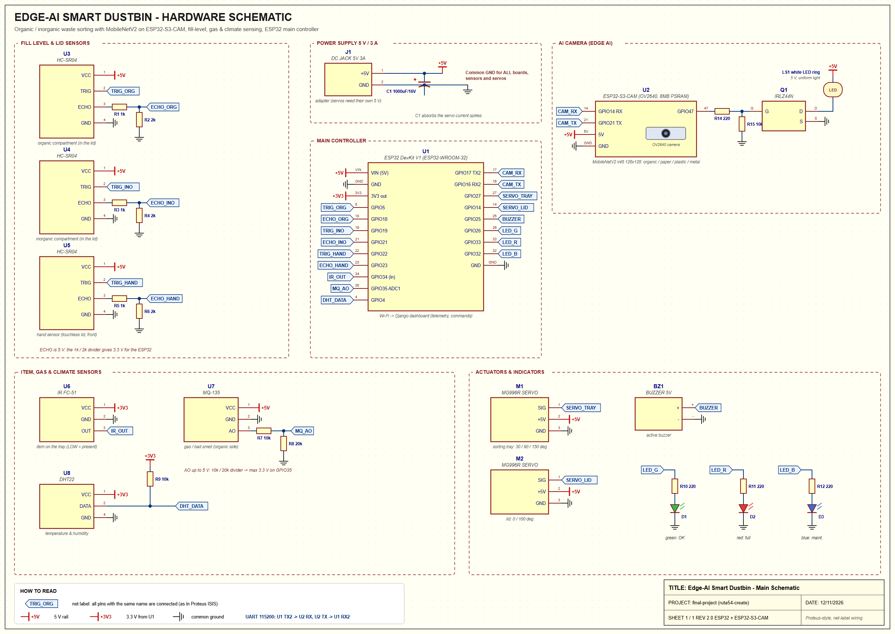

# Proteus Schematic

* Picture: `docs/schematic/smart_dustbin_schematic.png` (2480 × 1754, A-size). Vector version for printing or the
  report: `smart_dustbin_schematic.svg`.
* Drawn in Proteus ISIS style with **net labels**: all pins with the same label (for example `TRIG_ORG`) are connected.
* Generated from the real pin assignments in the firmware. After changing a pin, run `python tools/draw_schematic.py`.

## Parts on the schematic

| Ref | Part | Connects to |
|---|---|---|
| U1 | ESP32 DevKit V1 | main controller (all sensors and actuators) |
| U2 | ESP32-S3-CAM | AI camera, UART to U1 (GPIO17→14, GPIO21→16) |
| U3, U4, U5 | HC-SR04 | organic level (GPIO5/18), inorganic level (GPIO19/21), hand sensor (GPIO22/23) |
| R1–R6 | 1 kΩ / 2 kΩ | ECHO dividers 5 V → 3.3 V |
| U6 | IR FC-51 | item on tray → GPIO34 |
| U7, R7, R8 | MQ-135 + 10 kΩ / 20 kΩ | gas → GPIO35 (ADC1) |
| U8, R9 | DHT22 + 10 kΩ pull-up | temperature/humidity → GPIO4 |
| M1, M2 | MG996R servos | tray GPIO27, lid GPIO14 (powered from the 5 V adapter) |
| BZ1 | 5 V active buzzer | GPIO25 |
| D1–D3, R10–R12 | LEDs + 220 Ω | green GPIO26, red GPIO33, blue GPIO32 |
| Q1, R14, R15, LS1 | IRLZ44N + 220 Ω + 10 kΩ, white LED ring | camera light, U2 GPIO47 |
| J1, C1 | 5 V 3 A jack, 1000 µF | power for everything, common GND |

## Building it in Proteus 8 for simulation

Proteus can simulate the **sensors, servos, LEDs and buzzer**, but **not the camera, Wi-Fi or the AI model**.
Test those with `device/simulator.py` and the dashboard's **Test the AI** page.

| On the schematic | Proteus part (search in *Pick Devices*) | Note |
|---|---|---|
| ESP32 DevKit | not built in: add an "ESP32 library for Proteus" (for example The Engineering Projects), **or** use **ARDUINO MEGA 2560** with the same pin logic | simulates the controller code (Arduino IDE → *Export compiled binary* → load the .hex) |
| HC-SR04 | "Ultrasonic sensor library for Proteus" (The Engineering Projects) | its test pin sets the distance |
| MQ-135 | **POT-HG** potentiometer on the ADC pin | turn it to simulate rising gas |
| IR sensor | **LOGICSTATE** or a push button | LOW = item present |
| DHT22 | **DHT22** (built in) | |
| Servo | **MOTOR-PWMSERVO** | shows the angle |
| Buzzer | **BUZZER** / SOUNDER | |
| LEDs | **LED-GREEN**, **LED-RED**, **LED-BLUE** | |
| Resistors, capacitor | **RES**, **CAP-ELEC** | |
| MOSFET | **IRLZ44N** (or IRF540N if missing) | |
| Power | **POWER** (+5V), **GROUND**; use *Terminal Mode → Default* for net labels | |

Third-party library names and links change over time: search for "HC-SR04 Proteus library" and
"ESP32 Proteus library". Only download libraries from sources you trust.
