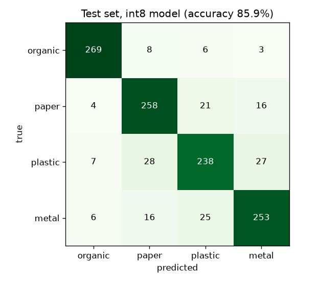
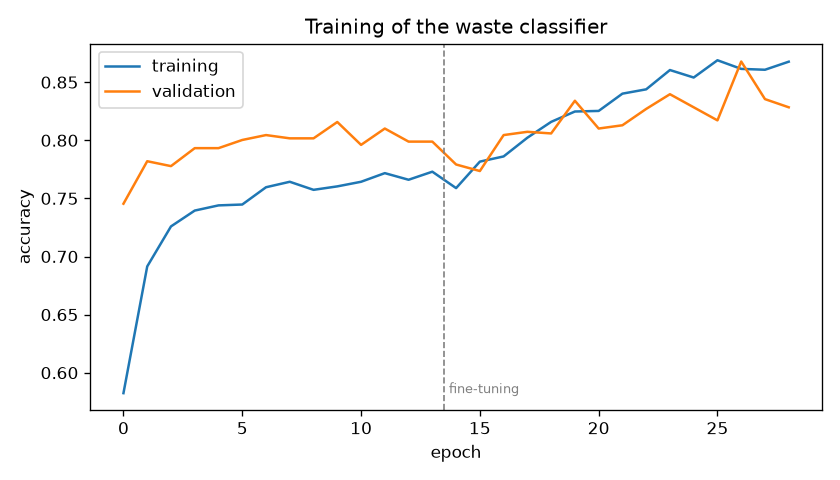

# Model card: Edge-AI Smart Dustbin waste classifier

* Model: MobileNetV2 alpha=0.35, input 128x128 RGB, transfer learning from ImageNet
* Classes: organic, paper, plastic, metal  →  organic compartment: organic + paper; inorganic: plastic + metal
* Training images: 4035 (+15 % validation), test images: 1185 (never seen in training)
* int8 TFLite size: 609 KB, 415,332 parameters
* Trained on a laptop CPU in 23.0 min

| Metric (test set) | float32 | int8 (on the ESP32) |
|---|---|---|
| Accuracy, 4 classes | 86.5% | 85.9% |
| Correct compartment | 91.8% | 91.3% |
| Accuracy on the v1 benchmark (709 photos the first model was tested on) | 88.0% | 86.6% |

| Class | Precision | Recall | F1 | Test images |
|---|---|---|---|---|
| organic | 0.94 | 0.94 | 0.94 | 286 |
| paper | 0.83 | 0.86 | 0.85 | 299 |
| plastic | 0.82 | 0.79 | 0.81 | 300 |
| metal | 0.85 | 0.84 | 0.84 | 300 |

**Data:** see `ml/datasets/processed/integration_report.md` (sources, subtypes, licences). **Limits:** trained mostly on public photos. Accuracy inside the real bin depends on adding your own ESP32 photos (see docs/DATASET_GUIDE.md, section 5) and retraining.
