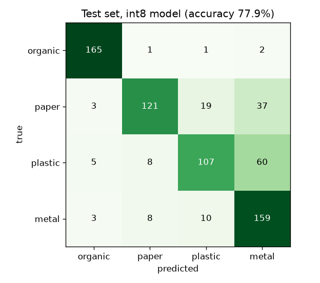
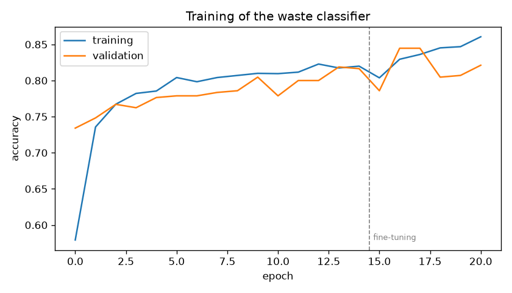

# Model card: Edge-AI Smart Dustbin waste classifier

* Model: MobileNetV2 alpha=0.35, input 96x96 RGB, transfer learning from ImageNet
* Classes: organic, paper, plastic, metal  →  organic compartment: organic + paper; inorganic: plastic + metal
* Training images: 2410 (+15 % validation), test images: 709 (never seen in training)
* int8 TFLite size: 609 KB, 415,332 parameters
* Trained on a laptop CPU in 7.3 min

| Metric (test set) | float32 | int8 (on the ESP32) |
|---|---|---|
| Accuracy, 4 classes | 83.8% | 77.9% |
| Correct compartment | 91.4% | 88.3% |

| Class | Precision | Recall | F1 | Test images |
|---|---|---|---|---|
| organic | 0.94 | 0.98 | 0.96 | 169 |
| paper | 0.88 | 0.67 | 0.76 | 180 |
| plastic | 0.78 | 0.59 | 0.68 | 180 |
| metal | 0.62 | 0.88 | 0.73 | 180 |

**Limits:** trained mostly on public photos (RealWaste, TrashNet). Accuracy inside the real bin depends on adding your own ESP32 photos (see docs/DATASET_GUIDE.md, section 5) and retraining.
