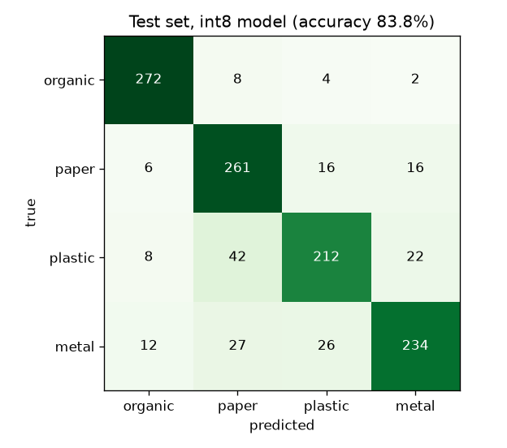
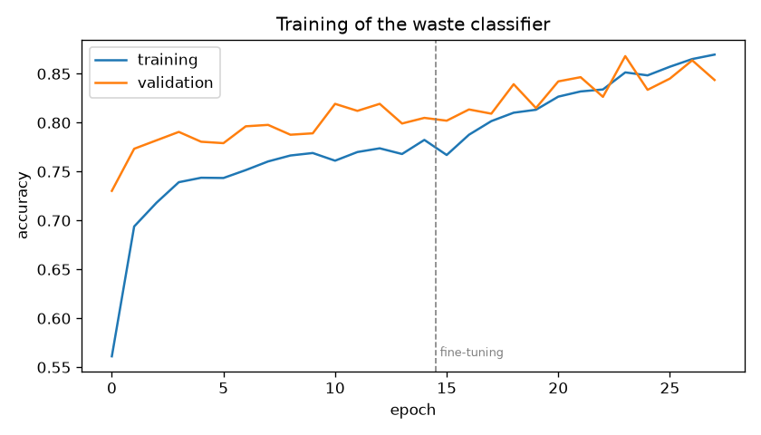

# Model card: Edge-AI Smart Dustbin waste classifier

* Model: MobileNetV2 alpha=0.35, input 128x128 RGB, transfer learning from ImageNet
* Classes: organic, paper, plastic, metal  →  organic compartment: organic + paper; inorganic: plastic + metal
* Training images: 3956 (+15 % validation), test images: 1168 (never seen in training)
* int8 TFLite size: 609 KB, 415,332 parameters
* Trained on a laptop CPU in 30.5 min

| Metric (test set) | float32 | int8 (on the ESP32) |
|---|---|---|
| Accuracy, 4 classes | 86.7% | 83.8% |
| Correct compartment | 91.3% | 89.1% |
| Accuracy on the v1 benchmark (709 photos the first model was tested on) | 86.6% | 84.5% |

| Class | Precision | Recall | F1 | Test images |
|---|---|---|---|---|
| organic | 0.91 | 0.95 | 0.93 | 286 |
| paper | 0.77 | 0.87 | 0.82 | 299 |
| plastic | 0.82 | 0.75 | 0.78 | 284 |
| metal | 0.85 | 0.78 | 0.82 | 299 |

**Data:** see `ml/datasets/processed/integration_report.md` (sources, subtypes, licences). **Limits:** trained mostly on public photos. Accuracy inside the real bin depends on adding your own ESP32 photos (see docs/DATASET_GUIDE.md, section 5) and retraining.
